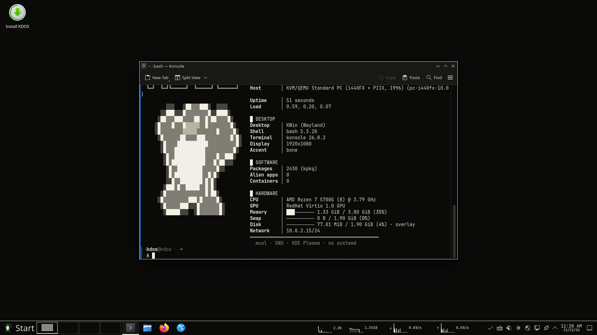
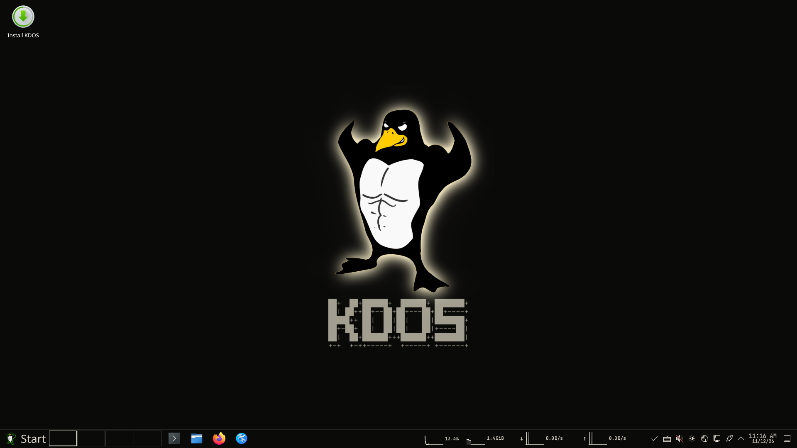
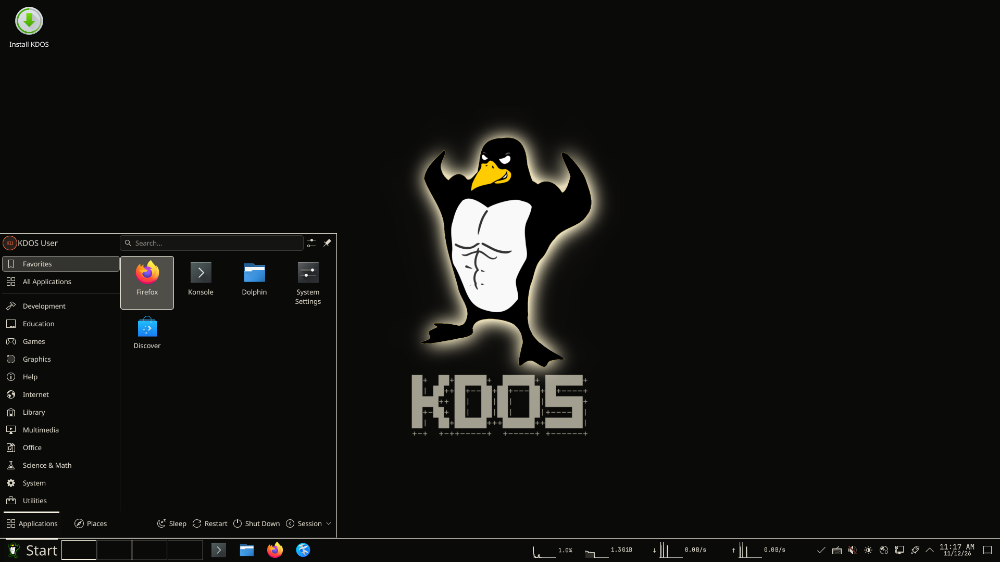
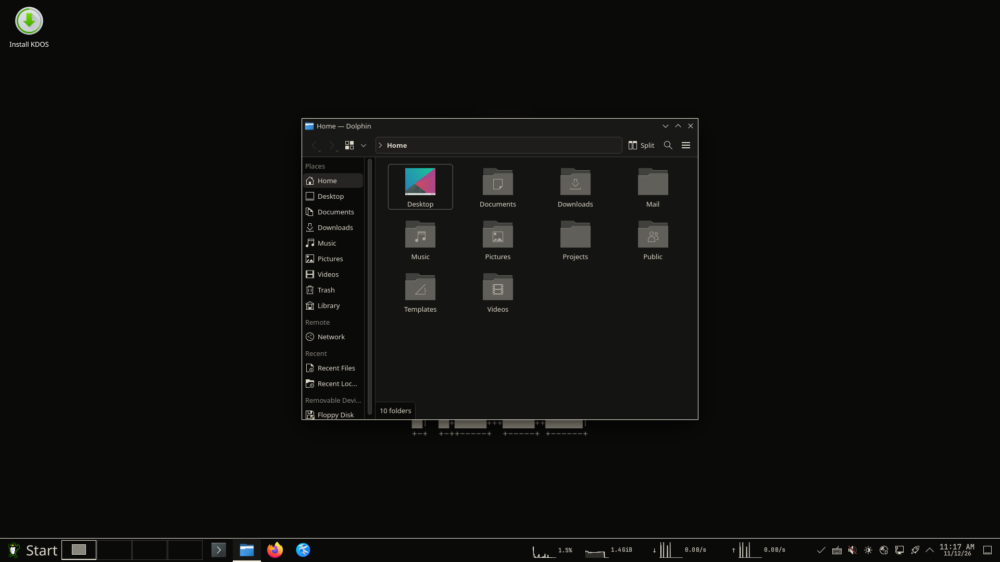
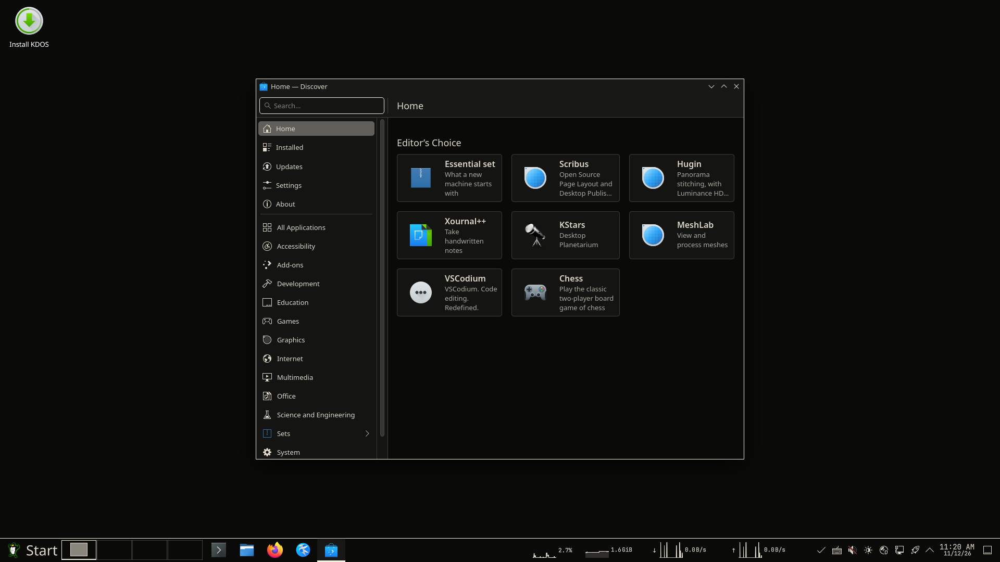
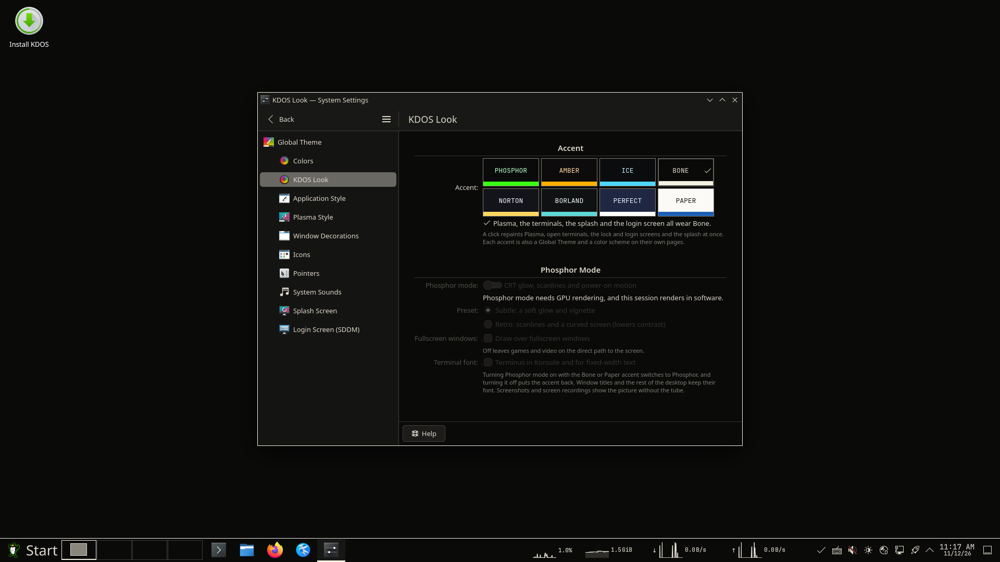
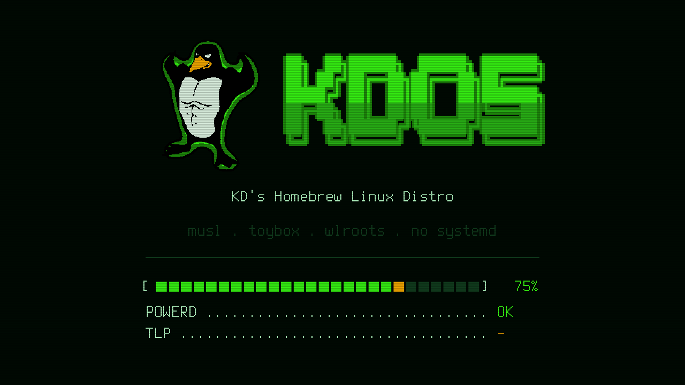

<p align="center">
  
</p>

<h1 align="center">KDOS</h1>

<p align="center">
<b>Kool Desktop Operating System</b><br>
A Linux distribution compiled from source, one <code>kpkgbuild</code> at a time,<br>
that boots into its own KDE Plasma desktop, made KDOS from the boot menu to the lock screen.
</p>

<p align="center">
<b>musl</b> · <b>GNU userland</b> · <b>sysvinit</b> · <b>KDE Plasma 6.8</b> · no systemd init · no Xorg · A/B updates
</p>

<p align="center">
<sub>a live ISO to download · about 2,400 native ports, every one prebuilt for the release · all of KDE Gear · 70 boxed applications · Linux 7.2.11</sub>
</p>

<p align="center">
  
</p>

<p align="center">
<sub>The live ISO's Plasma session in the Bone accent, Konsole running <code>fastfetch</code>.</sub>
</p>

---

KDOS stands for *Kool Desktop Operating System*. To the person who builds it, it is also *KD's
homebrew OS*: one person's distribution, compiled from upstream source in this repository.

This page is for anyone meeting KDOS for the first time: how to get it, try it and install it, how
to add software and keep it up to date, and, further down, how it is built. The full documentation
is a book under [`docs/kdos/`](docs/kdos/README.md).

## What you get

KDOS is a complete desktop operating system: a musl and GNU userland, the KDE Plasma desktop with
KDOS's own settings pages, widgets, KWin effects and look, signed A/B system updates, a package
manager, and an installer. It is released as a **live ISO**. Boot it from a USB stick or a virtual
machine, use it as it is, and install it to a disk when you want to keep it.

The ISO carries the **base system**: the Plasma session, the core KDE applications (Dolphin,
Konsole, Kate, Okular, Gwenview, Ark, Spectacle, KDE Connect and their companions), Firefox ESR,
Discover, networking, printing, the box stack, a compiler toolchain and the KDOS tools. Everything
else is one download away, three ways:

| Way | What it is | Use it for |
|---|---|---|
| **Native, prebuilt** | Any of KDOS's about 2,400 ports, compiled for this release and downloaded from its signed package host. Discover lists it under **KDOS system** | Almost everything: LibreOffice, GIMP, Krita, Inkscape, Blender, Kdenlive, digiKam, KMail, Thunderbird, Chromium, OBS Studio, QGIS, FreeCAD, KiCad, Wine, TeX Live and the rest of KDE Gear |
| **Native, built on this computer** | The same port compiled on your machine from its recipe, with what it needs downloaded prebuilt or built too, as you choose. Discover lists it under **KDOS, built on this computer** | Building it yourself, or a port with no prebuilt package |
| **Boxed** | A Debian application built on demand from KDOS's catalogue of 70, each in a rootless container of its own (a *box*) | Software KDOS does not port, a newer version than the native port, or anything you want kept apart from the system |

Native ports come in **groups** too, so a whole set installs in one step: KDE's games, education,
mail and calendar, multimedia, graphics, utilities and development tools, and KDOS's own office,
graphics, internet, multimedia, games, science, development and Windows groups. Choose groups in
the installer, or install one later from a terminal.

## Get KDOS

### Download

The current release is on the [releases page](https://github.com/kunaldawn/kdos/releases/latest),
marked **Latest**. Each release carries:

| File | What it is |
|---|---|
| `kdos-<version>.iso`, or `kdos-<version>.iso.part01`, `.part02`, … | The live ISO. GitHub holds no file over 2 GiB, so a larger ISO is cut into parts |
| `SHA256SUMS`, `SHA256SUMS.sig` | The checksum of the whole ISO and of every other file, and its signature |
| `kdos-release.pub` | The public half of the release key, key id `ccb53bac7fdba3cd` |
| `kfs.pdf`, `kfs-html.tar.zst` | *KDOS from Scratch*, the book of how every part is built |

The prebuilt packages and the update images sit in pre-releases beside it (`binhost-<version>-NN`,
`image-<version>`). You never download those by hand: a KDOS machine finds them through the
release's signed index.

Join the parts, if there are any, and check the result:

```sh
cat kdos-<version>.iso.part* > kdos-<version>.iso
sha256sum -c SHA256SUMS --ignore-missing
```

The last command must print `kdos-<version>.iso: OK`. A checksum list downloaded beside the file
proves only that the two agree; on a KDOS machine, `kdos verify kdos-<version>.iso` also checks the
list's signature against the release key the system already trusts.

### Try it in a virtual machine

Any x86-64 virtual machine with UEFI firmware and 4 GB of memory boots the ISO. With QEMU and the
OVMF firmware:

```sh
qemu-img create -f qcow2 kdos.qcow2 192G     # sparse: it uses only what is written
qemu-system-x86_64 -enable-kvm -cpu host -smp 4 -m 4G \
    -bios /usr/share/ovmf/OVMF.fd -cdrom kdos-<version>.iso \
    -drive file=kdos.qcow2,format=qcow2 -device virtio-vga -device virtio-net-pci,netdev=n \
    -netdev user,id=n -usb -device usb-tablet
```

Plain virtual graphics run KWin in software. Everything works except Phosphor mode and the CRT
motion, which need the guest to have hardware OpenGL (virgl).

### Write it to a USB stick

Use a stick at least as large as the ISO; this erases all of it. On Linux, with `/dev/sdX` the
stick:

```sh
sudo dd if=kdos-<version>.iso of=/dev/sdX bs=4M status=progress conv=fsync
```

On Windows or macOS, use any tool that writes a raw disk image (Rufus in DD mode, balenaEtcher).
The ISO boots from UEFI and from legacy BIOS. **Turn Secure Boot off** in the firmware first:
KDOS's boot loader is not signed for it.

### The live session

The ISO starts straight into Plasma as the user `kdos` (password `kdos`). Nothing you do there
touches your disks, and nothing you install there survives a restart: the live system lives in
memory. The Welcome Center opens first; close it, or pick one of the three desks it offers.

### Install

Open **Install KDOS** on the desktop, or run `sudo kinstall` in a terminal for the text-mode
installer. Both ask the same questions: keyboard and time zone, the disk (the whole disk, its existing
partitions, or ones you lay out; optionally encrypted), your account, the look, and the applications.
The installer writes nothing until you confirm its summary page.

On the **Applications** page you can tick:

- **KDOS applications**: native groups, downloaded prebuilt into the new system while it
  installs. This needs a network. Without one the choice is kept, and `sudo kdos update install
  --pending` installs it once the machine is online.
- **Boxed applications**: catalogue groups, recorded on the new disk and offered at your first
  login, where Discover builds them.

The disk must hold two system slots and your home; the installer's first page says how much that
is and offers only disks that are large enough. [Installation](docs/kdos/02-user-guide/installation.md)
walks through the installer page by page.

## Adding software

**In Discover**, search for a program and press Install. When a program can come from more than
one place, Discover's source picker lists each: *KDOS system* (prebuilt), *KDOS, built on this
computer*, and the boxed origins (*KDOS packs*, *Debian, built in a box*). Installing host
software asks for an administrator's password; building on this computer asks every time, since a
build runs for minutes to hours.

**In a terminal**, `kdos update install` does the same:

```sh
kdos update groups                          # every group, whether it is installed, and its download
sudo kdos update install office             # a group: LibreOffice, Calibre and TeXstudio
sudo kdos update install gimp               # one program, prebuilt
sudo kdos update install --source bat       # built here; what it lacks downloaded prebuilt
sudo kdos update install --source --build-deps=source bat    # built here, and what it lacks built too
kdos update install --dry-run kdenlive      # what would be downloaded or built, changing nothing
kdos app install app.scribus                # a boxed application from the catalogue
```

On the live ISO, `sudo kdos update fetch --binhost-only` first takes the release's package index;
what you install then lasts until the restart.

Which way a terminal install goes by default, and whether a build also builds what it lacks, are
set in **System Settings › System Versions › Installing software**. Every program keeps the way
it came: a program built here is built again at each update, a prebuilt one is downloaded again.
[Applications](docs/kdos/02-user-guide/applications.md) covers native programs, boxes and the
catalogue in full.

## Staying up to date

When a new release is out, Discover's **Updates** page offers it (or run
`sudo kdos update apply`). An update is written into the system slot you are not running, as a
signed whole-system image or, between releases, as prebuilt packages, and every program you
installed follows it into that slot. The next restart starts the new slot on trial; once it has
reached a working desktop it becomes the system, and if it does not, the computer goes back to the
old slot by itself. Nothing is downloaded until you ask: the nightly check reads only what is
already on the machine.

## What it looks like

Every picture is the live ISO, booted under QEMU with UEFI and software rendering at 1920×1080, in
the default Bone accent.

| | |
|---|---|
|  |  |
| The desktop and its panel, with CPU, memory and network meters | The launcher |
|  |  |
| Dolphin, from KDE Gear, built as a native port | Discover over native ports, packs and boxed applications |
|  |  |
| KDOS Look in System Settings: one click repaints Plasma, the terminals, the splash and the login screen | The boot splash |

## What is in it

| Area | What is there |
|---|---|
| The desktop | KDE Plasma 6.8 on KWin, with three desks to choose from at first login, eight accents applied everywhere at once from the boot menu to the lock screen, an optional Phosphor mode with a CRT pass over the whole screen, KDOS pages in System Settings (boxes, the firewall, health, the look, the system's versions), a KRunner runner for the `kdos` verbs and an offline library, privacy lamps that name the box holding the camera, and Discover over native ports, packs, boxes, firmware and system updates |
| On the ISO | The Plasma session; Konsole, Dolphin, Kate, Okular, Gwenview, Ark, Spectacle, KCalc, Elisa, KDE Connect, Partition Manager and Yakuake, with the KIO workers and thumbnailers they use; Firefox ESR, NetworkManager, PipeWire, CUPS and scanning, podman and the box stack, Python and Perl, and every KDOS tool and daemon |
| One download away | The rest of about 2,400 native ports, every one prebuilt for the release: all of KDE Gear (Kdenlive, digiKam, KMail, Krita and the rest), LibreOffice, GIMP, Inkscape, Blender, Thunderbird, Chromium, LibreWolf, OBS Studio, VLC, mpv, QGIS, FreeCAD, KiCad, TeX Live, Wine, Rust, Go, Node.js, Zig, Haskell, cross toolchains for ARM, RISC-V and AVR, and SDR and FPGA tooling, one at a time or in groups, among them `build-tools` (GCC's assembler and linker, make, CMake, Meson and the rest), `lang-zh`, `lang-ja` and `lang-ko` (input methods and CJK fonts) |
| Boxed | 70 catalogue applications, among them Zathura, Scribus, ParaView, Maxima, Scilab, VSCodium, Meld, Claws Mail and Hugin, each built on demand into its own box and [exportable as one file](docs/kdos/02-user-guide/applications.md#carrying-a-set-to-another-machine) that installs on another machine offline |
| Boot and install | A boot splash that hands over to the login screen, an optionally encrypted root, A/B root slots filled by signed whole-slot images with deltas, and an installer with a graphical front end and a text-mode one over one backend, which also runs unattended from an answer file |
| Its own software | 9 C libraries written for this system, the package manager and the installer, and 43 recipes of its own: 21 parts of the Plasma desktop, six root daemons, the box tools, the `kdos` command and its subcommands, and the artwork |

## How it differs

Most distributions ship glibc, GNU coreutils, systemd, an Xorg server beside Wayland, and binary
packages built elsewhere from sources you never see together. KDOS keeps the GNU core userland and
makes a different choice at each of the other points: musl for the C library; sysvinit's `init`
with runlevels, numbered shell scripts and the `ksvc` supervisor in place of systemd, with elogind
alone for logins and seats; Wayland only, SDDM's greeter included, with rootless Xwayland for X11
clients; KDE Plasma built unforked and made KDOS through settings, artwork and plugins rather than
patches. Every binary of a release, the ISO and every prebuilt package, is compiled from the about
2,400 recipes in this repository, with every source named by its SHA-256 and archived, so the
release can be rebuilt from the repository alone. Updates go into the machine's inactive root
slot and are kept only once the new slot boots to a working desktop.
[How KDOS differs](docs/kdos/01-philosophy/how-kdos-differs.md) compares each choice with the
usual alternatives, says why KDOS chose differently, and lists what is given up.

Four properties shape the rest of the tree.

**It is built from source, and the exceptions are listed.** Firmware, microcode, radio images and
emulator ROMs ship as upstream built them, most of it because no source is published. The Rust,
Go, Zig, Haskell, Java and OCaml compilers each need a working compiler of their own kind, so each
starts from a pinned upstream bootstrap. Some fonts, data with no other source form (models, maps,
game content) and a few web front ends ship as upstream built them. The boxed catalogue is Debian
binaries by design, and runs only in boxes. The complete list is in
[Why KDOS](docs/kdos/01-philosophy/why-kdos.md#what-is-not-built-from-source).

**KDOS can build KDOS.** The build's self-hosting phase, `20_selfhost`, rebuilds the C library and
the compilers inside the new system, with itself. The installed system carries GCC, Clang,
binutils, CMake, Meson, Ninja, Python, make and the package manager, so it can rebuild any port
of its own; Rust, Go and the other compilers arrive prebuilt the first time a build needs them.

**The build runs offline.** Every source file a recipe uses is named by a `sha256 =` line in that
recipe. `make fetch` is the one step that downloads sources; `make build` compiles in a container
started with `--network none`.

**Native first, boxes beside.** Graphical applications are ported natively, each with the
toolkit it is written in, and their recipes sit in `ports/core/` beside every other port, each on
one of 102 subject shelves: GIMP is `ports/core/graphics/gimp/`, Firefox ESR
`ports/core/browsers/firefox-esr/`. The boxed catalogue covers what is not ported, or ported at an
older version, and keeps each application in a rootless container of its own.

## Status and limits

This is the v0.2 line. Its interfaces are stable enough to document. It comes with no support
commitment and no tested hardware matrix: it is developed and tested in QEMU, and whoever runs it on
real hardware is the integrator.

Some things you may expect are not there. Secure Boot must be off. The login screen runs on a
Wayland greeter its upstream calls experimental. Phosphor mode needs hardware OpenGL. The system
speaks English only. Every such gap is listed in [Known gaps](docs/kdos/06-reference/known-gaps.md),
and the maturity of each subsystem, with the evidence behind each verdict, is in
[Status](docs/kdos/06-reference/status.md).

KDOS suits someone comfortable with a terminal, who wants a desktop whose every part they can read
and rebuild. It ships one user account, no telemetry, and no configuration layer between you and
the file that takes effect. Look elsewhere if you need broad hardware enablement or commercial
support.

## Building from source

You need a Linux machine with Docker, `git`, `curl`, `sha256sum`, a C compiler, and Python 3 for
the pre-push hook's book checks. Every compiler
the build itself uses runs inside a container built from the repository's `Dockerfile`, so no
other toolchain is installed on your machine.

| Cost | |
|---|---|
| Time | Many hours for the first build: the whole system is compiled, GCC several times over and the kernel included. Later builds are narrow and short |
| Disk | About 42.2 GB (39.3 GiB) of upstream sources, plus tens of gigabytes under `build/`, and more for a complete set of the optional [phase snapshots](docs/kdos/05-developer/build-system.md#snapshots) (the tree compressed once plus a layer per phase), whose total has not been measured |
| Network | For `git clone`, `make fetch`, and the first `make build`, which builds its container image. The compile itself runs with the network off |

```sh
git clone https://github.com/kunaldawn/kdos
cd kdos
git config core.hooksPath script/hooks   # once per clone: the pre-push checks (see Contributing)
make fetch                               # every upstream source, verified by sha256
make fetch-check                         # optional, offline: anything missing or wrong
make build                               # the result is build/iso-build/kdos.iso, the base image
make run
```

A clone holds recipes, not upstream archives. `make fetch` takes each file from the local cache
`ports/.srccache/`, then from the KDOS source archive (release assets of `kunaldawn/kdos`, located
through the committed `ports/sources.idx`), then from the recipe's upstream URL, and keeps the
first copy whose hash matches. Run it again after a pull or a branch switch; it downloads only what
is new. On a terminal, `make build` first opens a
[picker](docs/kdos/05-developer/build-system.md#the-startup-picker) that asks whether to start
fresh or restore a snapshot, and whether to write snapshots during the run.

The build compiles every port, and the ISO it writes carries the base: the closure of
[`ports/base`](ports/base). `make build KDOS_IMAGE=full` writes an ISO that carries every package
the build made, for a machine that installs offline; `make build KDOS_MAKE_BINHOST=1` also writes
the signed package host, `build/binhost`, that a release publishes for every machine running it.

[How KDOS is built](docs/kdos/05-developer/how-kdos-is-built.md) follows the build from
`git clone` to a bootable ISO, phase by phase. [Developing](docs/kdos/05-developer/developing.md)
lists every make target and shows how to rebuild one port, one desktop component or only the
packaging instead of everything.

## The book

The documentation under [`docs/kdos/`](docs/kdos/README.md) is one book in six parts. Its index
page carries the full table of contents and four reading paths.

| Part | Covers | Start with |
|---|---|---|
| I. Introduction | What KDOS is, how it differs, its principles and decisions | [Why KDOS](docs/kdos/01-philosophy/why-kdos.md) |
| II. Using KDOS | Installing, the desktop, applications, theming, administration, accessibility | [Getting started](docs/kdos/02-user-guide/getting-started.md) |
| III. Architecture | Boot, the session, packaging, packs and boxes, security, design, windows | [Architecture overview](docs/kdos/03-architecture/overview.md) |
| IV. Programs | KWin, the Plasma shell, KDOS's settings pages, Discover, boxes, the daemons, the installer, the `kdos` command | [The programs](docs/kdos/04-programs/README.md) |
| V. Building and developing | The build, recipes, the C libraries, desktop software, testing | [How KDOS is built](docs/kdos/05-developer/how-kdos-is-built.md) |
| VI. Reference | Ports, commands, configuration, paths, gaps, status, glossary | [Command index](docs/kdos/06-reference/command-index.md) |

A second book, *KDOS from Scratch* under [`docs/kfs/`](docs/kfs/README.md), builds the system
phase by phase and package by package, with a page for every port. Both books are on every image,
under `/usr/share/doc/kdos` and `/usr/share/doc/kfs`, and both are published to the repository's
GitHub Pages site on every push to `main`; each `v` release carries *KDOS from Scratch* as one PDF
and as an HTML tarball.

## Repository layout

```
ports/core/       about 2,400 upstream ports on 102 shelves, ports/core/<shelf>/<name>/: a kpkgbuild
                  and a build.sh each, patches where needed
ports/            the shelf list (shelves), the fetch, update and publish tools, sources.idx,
                  unbuilt (the recipes no phase builds), base and buildonly (what the ISO
                  carries), and groups (the native groups)
src/libs/         9 C libraries written for this system
src/desktop/      KDOS's parts of the Plasma desktop: settings pages, widgets, KWin effects and
                  scripts, the Discover backend, the runner, the graphical installer
src/daemons/      the six root daemons the desktop talks to
src/system/       the package manager, the kdos command, packs, boxes and the box socket, the
                  installer, and the two books on the image
src/art/          the identity generators, icons, wallpapers, sounds, the login theme, the
                  add-ons, the boot splash, the demo
src/devtools/     kdosbuild (the orchestrator behind make build) and kdos-portup (behind
                  ports/update)
fs/               copied as-is into the target root filesystem
script/           kdosbuild.sh (what make build runs), the shared environments under env/,
                  the shared port lookup under lib/, the chroot's entry under chroot/,
                  the ninja and meson wrappers on the chroot's PATH under bin/,
                  and the pre-push hook under hooks/
script/phases/    the thirteen build phases, each with its phase.env and either its
                  numbered step scripts or its package list (packages.txt or packages.d/)
testing/          preflight, the self-test, the Qt suite, fixtures, the QEMU rig
docs/kdos/        the book
docs/kfs/         KDOS from Scratch, rendered by script/book/ (make book)
.github/          the workflow that publishes both books to GitHub Pages and each release
```

[Repository layout](docs/kdos/06-reference/repository-layout.md) annotates every directory.

## Contributing

Most contributions are ports: adding a piece of software or updating one. A port is a directory
on one shelf of `ports/core/`, `ports/core/<shelf>/<name>/`, holding two files, `kpkgbuild`
(declarative metadata) and `build.sh`, with any patches beside them and, for a port that needs
one, a [`kfs.md`](docs/kdos/05-developer/writing-ports.md#the-ports-note-kfsmd) explaining its
flags and patches for *KDOS from Scratch*.
[Writing ports](docs/kdos/05-developer/writing-ports.md) covers the format and walks through adding
a port end to end. A version bump looks like this:

```sh
ports/update <port>                 # accept the new version; the version and sha256 lines are rewritten and the source fetched
testing/preflight.sh                # the tree's wiring, in two to three minutes
grep -rlx <port> script/phases/*/packages*                              # which phase lists the port
make build BUILD_ARGS="--phases <phase>,70_image --rebuild <port>"     # that phase, e.g. 41_system
ports/publish <port>                # upload the new source and add its line to ports/sources.idx (maintainer token)
make book-stamp                     # rewrite docs/kfs/data/recipes.stamp for the new recipe and index
git commit ports/core/<shelf>/<port> ports/sources.idx docs/kfs/data/recipes.stamp
git push                            # the pre-push hook checks the layout, patches, the books and the archive
```

Uploading to the source archive needs write access to `kunaldawn/kdos`. Without it, run
`ports/publish --check <port>` to list what the archive lacks and name those ports in your pull
request, so a maintainer publishes them.

The pre-push hook runs four checks in turn, and each has a variable that skips it:

| Check | Refuses a push when | Skip with |
|---|---|---|
| Layout | at the tip of a pushed ref, a recipe is not exactly at `ports/core/<shelf>/<name>/`, its shelf is not listed in that commit's `ports/shelves`, a shelf is named `libs`, `core` or after a port, or a bare name is held twice across `ports/core` and `src/<area>/` | `KDOS_SKIP_LAYOUT_CHECK=1` |
| Patches | a new or changed `.patch` or `.diff` has no `Subject:` line saying what it changes | `KDOS_SKIP_PATCH_CHECK=1` |
| Books | `testing/docscheck.sh` or `testing/kfscheck.py` fails on the working copy, a stale recipe stamp included | `KDOS_SKIP_BOOK_CHECK=1` |
| Archive | a hash a pushed recipe names is missing from the committed `ports/sources.idx` or from the archive, or the archive cannot be reached at all | `KDOS_SKIP_PUBLISH_CHECK=1` |

The book check reads the working copy rather than the pushed commit, so push from a checkout of
what you are pushing. Testing describes what
[`docscheck.sh`](docs/kdos/05-developer/testing.md#docschecksh) and
[`kfscheck.py`](docs/kdos/05-developer/testing.md#kfscheckpy) measure.

Two rules apply to every change. A change updates the documentation that describes the behaviour
it changes, in the same commit. And the host carries no systemd init or service manager and no
Xorg server: elogind is the one login manager, and Xwayland the one X server. The
reasons are in [Principles](docs/kdos/01-philosophy/principles.md), and the test harnesses that check a change
before a full build are in [Testing](docs/kdos/05-developer/testing.md).

## Licence

The KDOS-authored parts are MIT (see [`LICENSE`](LICENSE)). `src/art/kdos-addons/LICENSE.notice`
records the palettes its colour schemes are made from and their licences. Monocypher, vendored in
`libksig`, is dual-licensed BSD-2-Clause or CC0-1.0. `kdos-bb` is a fork of a GPL-2.0 project and
keeps that licence along with its upstream copyright headers. `kdos-sddm-theme` is a patched copy
of Breeze's SDDM theme and keeps its LGPL-2.0-or-later licence. KWin's `kdos-crt.patch` adds files
under GPL-2.0-only. Every port under `ports/core/` is upstream's own code under upstream's own
terms.
