<!-- This file is written by script/site/mksite.py from site/home.md, which kdos.dev is made from as well.
     Edit site/home.md and run `make site`; `make sitecheck` fails while the two differ. -->

<p align="center">
  <a href="https://kdos.dev/">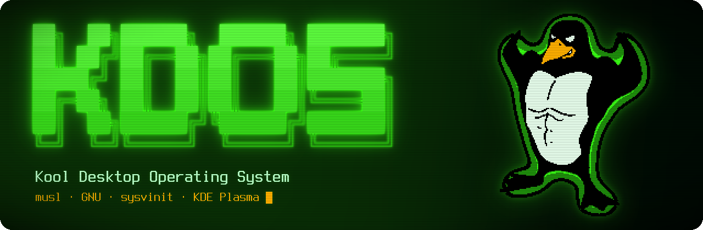</a>
</p>

<p align="center">
  An independent Linux distribution that compiles every package from source and ships it prebuilt, with musl, sysvinit and KDE Plasma on Wayland, and one retro look from the boot menu to the lock screen: eight colour schemes, called accents, and an optional CRT mode.
</p>

<p align="center">
  <a href="https://github.com/kunaldawn/kdos/releases/tag/v0.2"><b>Download KDOS 0.2</b></a> · <a href="docs/kdos/README.md"><b>Read the book</b></a> · <a href="https://kdos.dev/"><b>kdos.dev</b></a>
</p>

<p align="center"><sub>x86-64 · UEFI or BIOS · a live ISO under 2 GB</sub></p>

<p align="center">
  
  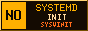
  
  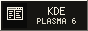
  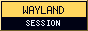
  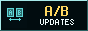
  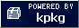
  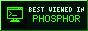
</p>

## At a glance

<table>
<tr><th align="left">Based on</th><td>Independent: built from source in <a href="https://github.com/kunaldawn/kdos" rel="noopener">its own repository</a>, not derived from another distribution</td></tr>
<tr><th align="left">Architecture</th><td>x86-64</td></tr>
<tr><th align="left">Desktop</th><td>KDE Plasma 6.8.2 on Wayland, with KDE Frameworks 6.31 and KDE Gear 26.08.2</td></tr>
<tr><th align="left">Init</th><td>sysvinit 3.18, services supervised by <code>ksvc</code>; elogind for login sessions</td></tr>
<tr><th align="left">C library</th><td>musl 1.2.6, with the GNU userland</td></tr>
<tr><th align="left">Kernel</th><td>Linux 7.2.11</td></tr>
<tr><th align="left">On the ISO</th><td>Plasma with Konsole, Dolphin, Kate, Okular, Gwenview, Ark, Spectacle, Elisa, Haruna, KDE Connect and Discover; Firefox ESR 153.5.0 and VLC; the Orca screen reader and BRLTTY for braille displays; no compiler (the <code>build-tools</code> group adds one)</td></tr>
<tr><th align="left">Software</th><td>2,446 native packages, called <em>ports</em>, every one prebuilt for the release. Beside them, applications built from Debian's packages run in containers of their own, called <em>boxes</em>: the 69 that KDOS's own catalogue picks and sets up, offered by the installer, Discover and <code>kdos app</code>, and, in Discover, nearly every other Debian desktop application</td></tr>
<tr><th align="left">Package tools</th><td><code>kpkg</code>, KDOS's own package manager; <code>kdos update</code>; and Discover</td></tr>
<tr><th align="left">Updates</th><td>Signed. On a whole-disk install of 25 GiB or more, a new release goes into a second system slot and is rolled back automatically if it does not start; with one slot, its packages install over the running system</td></tr>
<tr><th align="left">Release model</th><td>Fixed releases, not rolling; a machine changes version only when it takes the next release</td></tr>
<tr><th align="left">Release</th><td>0.2, a live ISO under 2 GB that installs to disk</td></tr>
<tr><th align="left">Status</th><td>An early release by one person, tested in virtual machines: see <a href="#status-and-limits">Status and limits</a></td></tr>
<tr><th align="left">Developer</th><td>Kunal Dawn</td></tr>
<tr><th align="left">Origin</th><td>India</td></tr>
<tr><th align="left">Category</th><td>Desktop, live medium</td></tr>
<tr><th align="left">Support</th><td><a href="https://github.com/kunaldawn/kdos/issues" rel="noopener">GitHub issues</a>, for bugs and questions alike; there is no forum or mailing list</td></tr>
<tr><th align="left">Licence</th><td>MIT for KDOS's own code, except two programs derived from other projects; each upstream project's own licence for the rest</td></tr>
</table>

## Screenshots

Every picture is KDOS 0.2, photographed in a virtual machine.

### The desktop

<table>
<tr>
<td align="center" valign="top" width="33%"><a href="site/assets/shots/desktop.webp">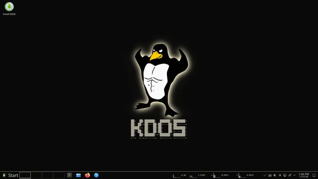</a><br><sub>The live desktop: KDE Plasma in Bone, the default accent, with the KDOS mascot as wallpaper.</sub></td>
<td align="center" valign="top" width="33%"><a href="site/assets/shots/start-menu.webp">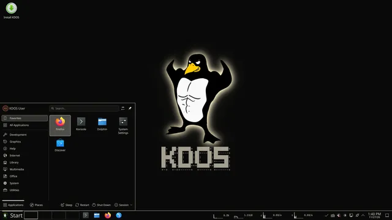</a><br><sub>The Start menu opens on favourites, with every application sorted into categories down the side.</sub></td>
<td align="center" valign="top" width="33%"><a href="site/assets/shots/overview.webp">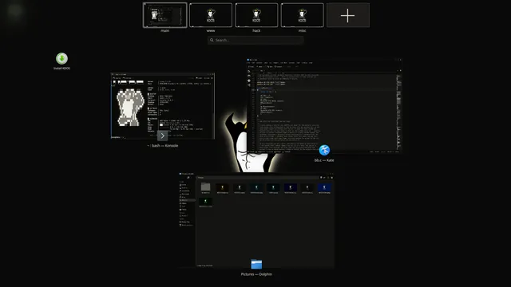</a><br><sub>The Overview spreads out every window and the workspaces, and searches as you type.</sub></td>
</tr>
<tr>
<td align="center" valign="top" width="33%"><a href="site/assets/shots/krunner.webp">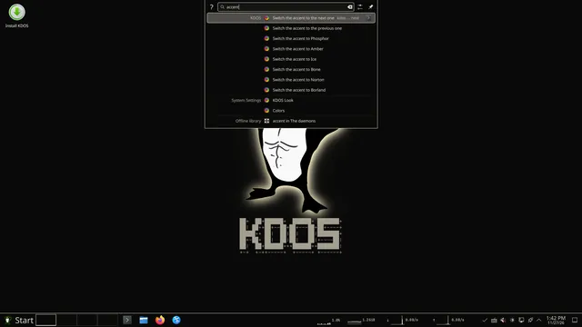</a><br><sub>KRunner launches applications, runs commands and changes settings from one search box: typing accent offers the accents and the KDOS Look page.</sub></td>
<td align="center" valign="top" width="33%"><a href="site/assets/shots/desk-dock.webp">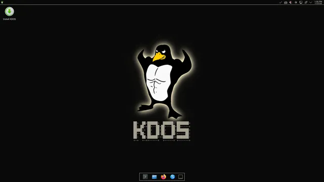</a><br><sub>Dock, one of the three desks (panel layouts), puts a bar at the top and a floating dock at the bottom.</sub></td>
<td align="center" valign="top" width="33%"><a href="site/assets/shots/desk-tiling.webp">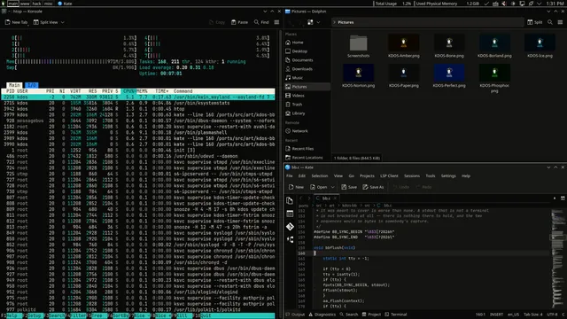</a><br><sub>Tiling, another desk, lays windows out side by side by itself, under a bar along the top.</sub></td>
</tr>
</table>

### Applications

<table>
<tr>
<td align="center" valign="top" width="33%"><a href="site/assets/shots/terminal.webp">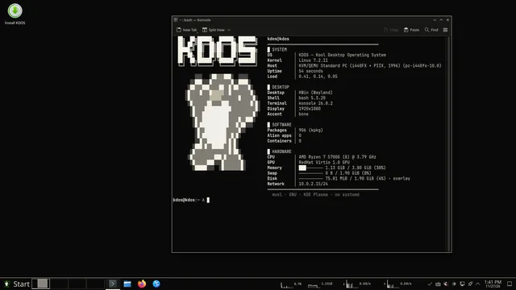</a><br><sub>Konsole running fastfetch, which names the system, the desktop, the accent and the hardware.</sub></td>
<td align="center" valign="top" width="33%"><a href="site/assets/shots/dolphin.webp">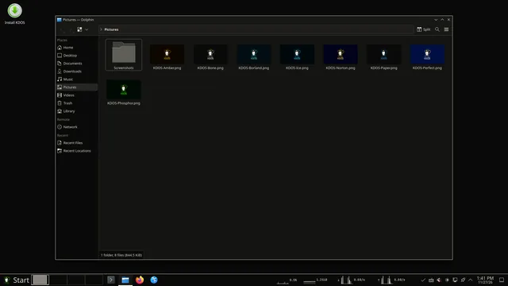</a><br><sub>Dolphin, the file manager, with previews of the wallpaper each accent brings.</sub></td>
<td align="center" valign="top" width="33%"><a href="site/assets/shots/kate.webp">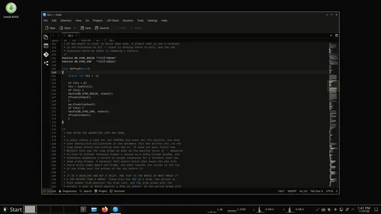</a><br><sub>Kate, the text editor, with C source code from the kdos-bb demo open.</sub></td>
</tr>
<tr>
<td align="center" valign="top" width="33%"><a href="site/assets/shots/okular.webp">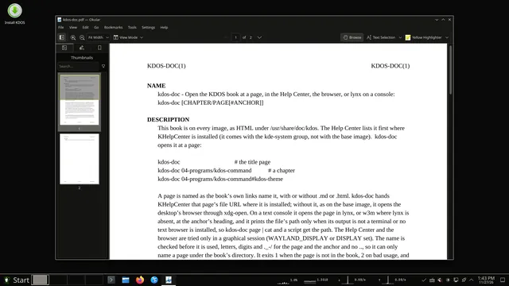</a><br><sub>Okular, the document viewer, reading the manual of kdos-doc, which opens the KDOS book that every machine carries.</sub></td>
<td align="center" valign="top" width="33%"><a href="site/assets/shots/discover.webp">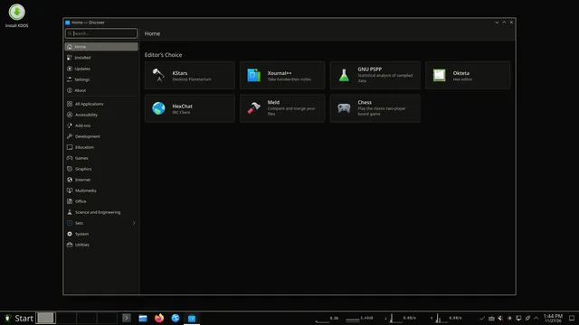</a><br><sub>Discover, the software centre, which installs applications and system updates.</sub></td>
<td align="center" valign="top" width="33%"><a href="site/assets/shots/discover-app.webp">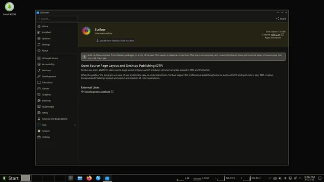</a><br><sub>Discover also offers applications KDOS does not build itself, such as Scribus, built from Debian's packages into a box of their own.</sub></td>
</tr>
</table>

### Accents and Phosphor mode

<table>
<tr>
<td align="center" valign="top" width="50%"><a href="site/assets/shots/phosphor-mode.webp">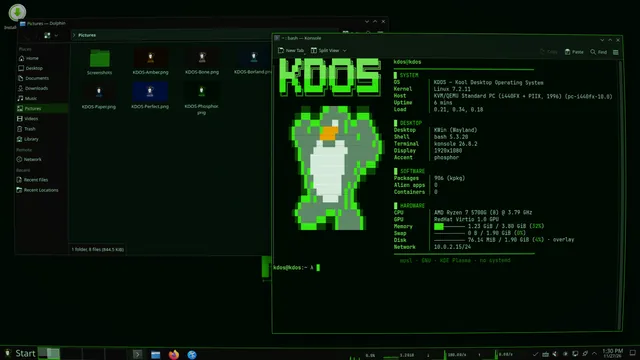</a><br><sub>Phosphor mode draws the whole screen as a CRT, here in the Phosphor accent with scanlines and curved glass.</sub></td>
<td align="center" valign="top" width="50%"><a href="site/assets/shots/settings-look.webp">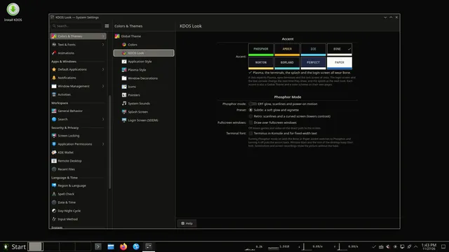</a><br><sub>The KDOS Look page in System Settings picks an accent and turns Phosphor mode on.</sub></td>
</tr>
</table>

### Terminal and console

<table>
<tr>
<td align="center" valign="top" width="25%"><a href="site/assets/shots/console.webp">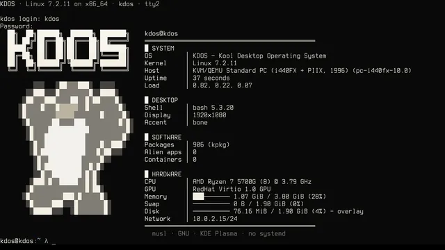</a><br><sub>The text console greets a login with the logo and the system's details in a large retro font.</sub></td>
<td align="center" valign="top" width="25%"><a href="site/assets/shots/kdos-command.webp">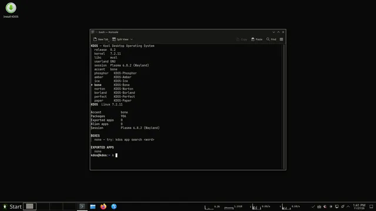</a><br><sub>The kdos command reports the release, the accents and the state of the system, and changes them.</sub></td>
<td align="center" valign="top" width="25%"><a href="site/assets/shots/kdos-bb.webp">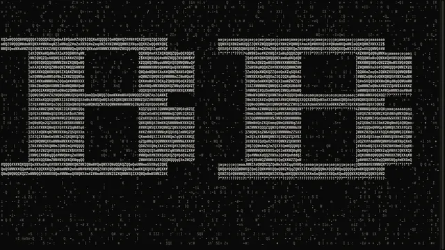</a><br><sub>kdos-bb, a text-mode demo from 1997 that ships with KDOS, playing its opening titles in Konsole.</sub></td>
<td align="center" valign="top" width="25%"><a href="site/assets/shots/kdos-bb-face.webp">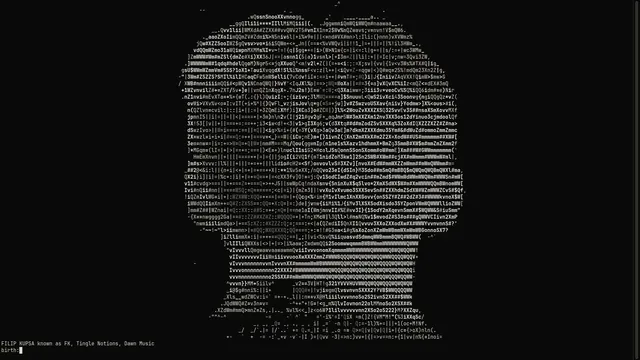</a><br><sub>kdos-bb draws portraits of its authors in nothing but text characters.</sub></td>
</tr>
</table>

### Boot, login and install

<table>
<tr>
<td align="center" valign="top" width="25%"><a href="site/assets/shots/limine.webp">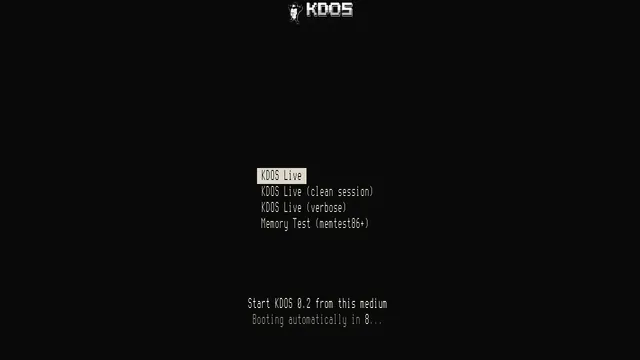</a><br><sub>The live medium's boot menu, counting down to the live session.</sub></td>
<td align="center" valign="top" width="25%"><a href="site/assets/shots/splash.webp">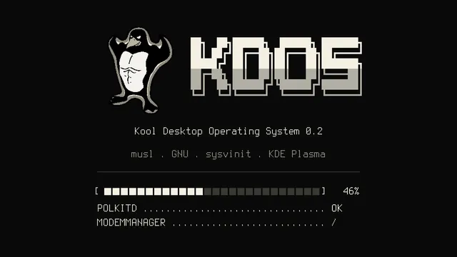</a><br><sub>The boot splash names each service as it starts, under a progress bar.</sub></td>
<td align="center" valign="top" width="25%"><a href="site/assets/shots/greeter.webp">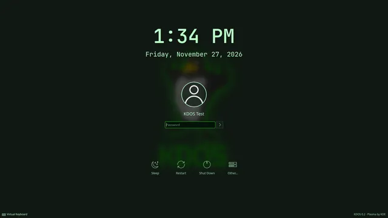</a><br><sub>The login screen of an installed system, here wearing the Phosphor accent chosen at install time.</sub></td>
<td align="center" valign="top" width="25%"><a href="site/assets/shots/lock-screen.webp">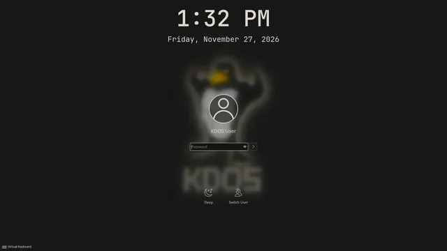</a><br><sub>The lock screen, with the clock over a blurred wallpaper.</sub></td>
</tr>
<tr>
<td align="center" valign="top" width="25%"><a href="site/assets/shots/welcome.webp">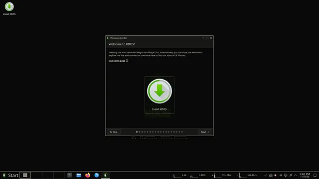</a><br><sub>Welcome Center opens on the first login; on the live system its first page starts the installer.</sub></td>
<td align="center" valign="top" width="25%"><a href="site/assets/shots/installer-welcome.webp">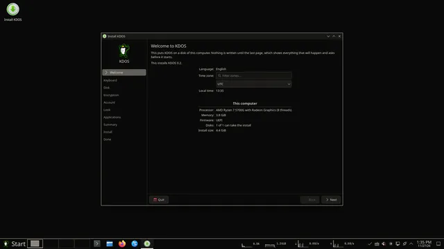</a><br><sub>The installer's first page shows what it found: processor, memory, firmware, disks and the install size.</sub></td>
<td align="center" valign="top" width="25%"><a href="site/assets/shots/installer-disk.webp">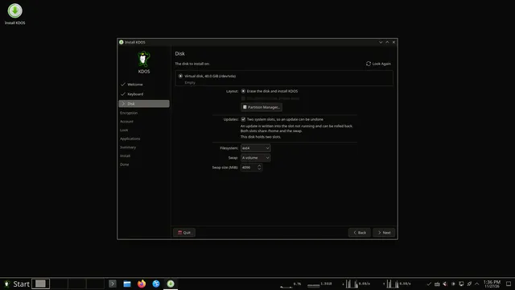</a><br><sub>The Disk page erases a disk or reuses partitions, with two system slots so that an update can be undone.</sub></td>
<td align="center" valign="top" width="25%"><a href="site/assets/shots/installer-look.webp">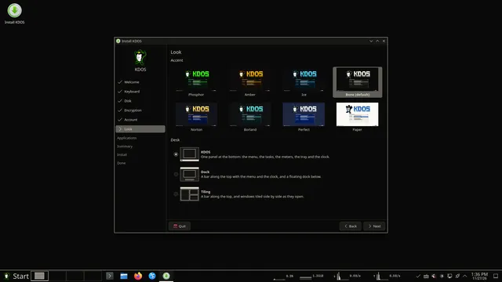</a><br><sub>The Look page picks the accent and the desk before the first login.</sub></td>
</tr>
</table>

## What makes it different

Most desktop distributions use glibc and systemd; KDOS uses musl and sysvinit, and builds every package of a release from source. The book says what each choice costs: [How KDOS differs](docs/kdos/01-philosophy/how-kdos-differs.md).

### Built from source

Every binary in a release, on the ISO and on its package server, is compiled from the build recipes in one repository. Every source file is pinned by its SHA-256 and archived, so a release can be rebuilt from the repository and its source archive. The few exceptions, firmware among them, are [listed](docs/kdos/01-philosophy/why-kdos.md#what-is-not-built-from-source).

### No systemd init

PID 1 is sysvinit, with runlevels and numbered shell scripts you can read, and `ksvc` supervises the services. Logins and sessions are elogind's job, so Plasma has what it needs.

### musl with GNU tools

KDOS pairs musl, a small C library you can read, with the full GNU userland (coreutils, grep, sed, gawk, findutils and tar) and util-linux, so the everyday commands are the same programs, with the same options, as on other Linux systems.

### Plasma, the KDOS way

KDE Plasma and nearly all of KDE Gear are built from upstream releases and patched only where no build option does the job. The session is Wayland only, with Xwayland for X11 programs. KDOS adds its own System Settings pages, widgets, KWin effects and a KRunner runner, and a look that runs from the boot menu to the lock screen.

### Updates you can undo

An install that erases a large enough disk gets two system slots, and an update is written whole into the one you are not running. The next restart tries it, and if it does not start, the computer goes back to the version that worked; System Settings can start the other version at the next boot whenever you like.

### Software three ways

Install any of the 2,446 ports prebuilt or build one from its recipe, or run a Debian application in a box: [Adding software](#adding-software).

### Signed end to end

The recipes, the package index, every package and the update image are signed, and a KDOS machine checks each against the keys it carries before it installs any of them. The ISO's checksum list is signed too, for you to check before you boot it.

### The book on board

Every KDOS machine carries the KDOS book, a complete description of the system, and opens it offline with `kdos-doc`. The `kdos-*` programs, `kpkg`, `ksvc` and `kinstall` have manual pages made from the book, `man 7 kdos` points into it, and `kdos help` lists the `kdos` commands.

## Eight accents

KDOS comes in eight colour schemes called accents. One click on the KDOS Look page in System Settings, or `kdos theme amber` in a terminal, repaints Plasma, every KDE application, the open terminals and the lock screen at once, and the login screen, the text consoles, the splash and the boot menu the next time each appears. Bone is the default.

Each card opens a screenshot of the desktop in that accent.

<table>
<tr>
<td align="center" width="25%"><a href="site/assets/shots/accent-phosphor.webp">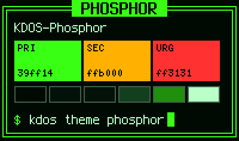</a><br><sub><b>Phosphor</b></sub></td>
<td align="center" width="25%"><a href="site/assets/shots/accent-amber.webp">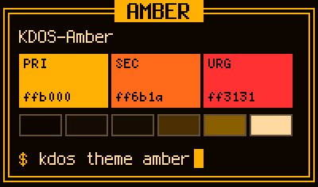</a><br><sub><b>Amber</b></sub></td>
<td align="center" width="25%"><a href="site/assets/shots/accent-ice.webp">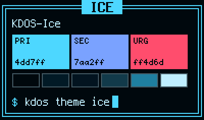</a><br><sub><b>Ice</b></sub></td>
<td align="center" width="25%"><a href="site/assets/shots/start-menu.webp">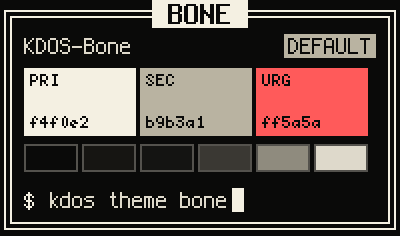</a><br><sub><b>Bone (default)</b></sub></td>
</tr>
<tr>
<td align="center" width="25%"><a href="site/assets/shots/accent-norton.webp">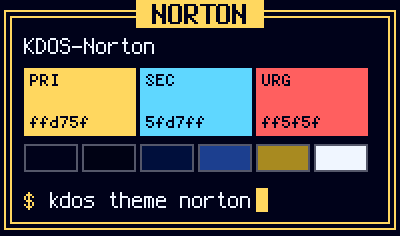</a><br><sub><b>Norton</b></sub></td>
<td align="center" width="25%"><a href="site/assets/shots/accent-borland.webp">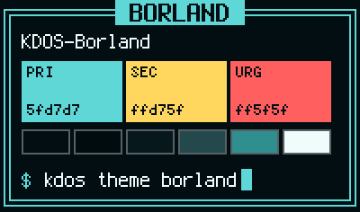</a><br><sub><b>Borland</b></sub></td>
<td align="center" width="25%"><a href="site/assets/shots/accent-perfect.webp">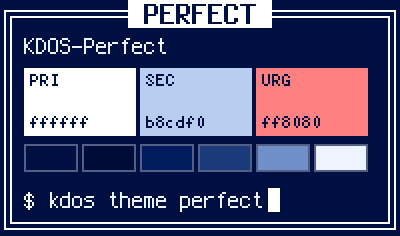</a><br><sub><b>Perfect</b></sub></td>
<td align="center" width="25%"><a href="site/assets/shots/accent-paper.webp">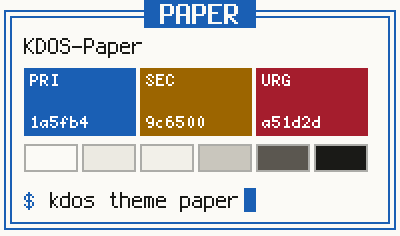</a><br><sub><b>Paper</b></sub></td>
</tr>
</table>

*Phosphor mode*, a switch on the same KDOS Look page in System Settings, turns your whole screen into a CRT: a phosphor glow, scanlines and curved glass if you like, windows that unfold from a line, and a desktop that warms up like a picture tube after the login. Bone and Paper give way to Phosphor's green for it; the other accents keep their colours. It needs hardware OpenGL, so a virtual machine needs 3D acceleration (virgl in QEMU). [Theming](docs/kdos/02-user-guide/theming.md) covers both.

## Status and limits

KDOS 0.2 is an early release by one person, developed and tested in virtual machines. It comes with no warranty and no list of tested hardware, so on real hardware you may be the first to try your combination of parts. It suits someone at home in a terminal who wants a desktop whose every part they can read and rebuild.

Know these before you try it:

- **Dual boot:** the installer does not shrink partitions, so installing beside Windows or another Linux takes [manual steps](docs/kdos/02-user-guide/installation.md#beside-another-system) and gives one system slot, with no undo for updates. KDOS's boot menu lists only KDOS: on UEFI, start the other system from the firmware's boot menu; on BIOS, KDOS's boot loader takes the disk's boot code, so the other system cannot start from that disk.
- **Firmware:** the ISO carries firmware for Intel, AMD, MediaTek and Realtek hardware. Qualcomm and Broadcom Wi-Fi cards, NVIDIA graphics from the GeForce GTX 950 (second-generation Maxwell) on, and the speaker amplifiers of many laptops need firmware from the network: the installer adds it when it has a connection, and `sudo kdos firmware sync` adds it later, over Ethernet, a USB-tethered phone or a Wi-Fi card that works.
- **NVIDIA:** the open nouveau and NVK drivers only; there is no proprietary NVIDIA driver.
- **Outside software:** there is no Flatpak or Snap, and programs shipped as glibc binaries, such as most commercial software and AppImages, do not run natively: they run in a box or not at all. Windows programs have Wine.
- **Language:** every program speaks English only, and Chinese, Japanese and Korean text shows as boxes until its fonts are installed: `sudo kdos update install lang-zh` (or `lang-ja`, `lang-ko`).
- **Power:** KDOS suspends to memory, but resuming has not been tested on real hardware, and a virtual machine with QEMU's virtio-gpu offers no Sleep, since that driver [does not survive a resume](docs/kdos/06-reference/known-gaps.md#a-virtio-gpu-machine-is-offered-no-suspend); there is no hibernation.
- **Crash reports:** a crashed program shows no crash dialog.
- **Add-on downloads:** Plasma's *Get New* downloads of themes and widgets are switched off; KDOS's own wallpapers, colour schemes and widgets come on the ISO.
- **Login screen:** SDDM's Wayland greeter, which its upstream still calls experimental.
- **Updates:** moving an installed machine from one published release to the next has not been tested yet.
- **Security fixes:** they reach a machine only with a new release, and there is no security-advisory service; `kdos cve` lists the installed packages that are behind a known fix, offline.

[Known gaps](docs/kdos/06-reference/known-gaps.md) lists every gap, and [Status](docs/kdos/06-reference/status.md) how mature each part is, with the evidence.

## Get KDOS

KDOS 0.2 is a live ISO. Boot it from a USB stick or in a virtual machine, use it as it is, and install it to a disk when you want to keep it.

You need:

- a 64-bit x86 PC with UEFI or BIOS firmware, and **Secure Boot turned off**: KDOS's boot loader is not signed for it
- 4 GB of memory or more
- a USB stick of 2 GB or more, or a virtual machine
- to install, a disk of 25 GiB (27 GB) or more for the two system slots that let an update be undone, or 21 GiB (23 GB) without swap; a smaller disk, down to about 8 GiB without swap, gets one slot and no undo
- a network for software beyond the ISO

### Download

The [release page](https://github.com/kunaldawn/kdos/releases/tag/v0.2) has the ISO and the files that prove it is KDOS's:

- [`kdos-v0.2.iso`](https://github.com/kunaldawn/kdos/releases/download/v0.2/kdos-v0.2.iso), the live ISO
- [`SHA256SUMS`](https://github.com/kunaldawn/kdos/releases/download/v0.2/SHA256SUMS) and [`SHA256SUMS.sig`](https://github.com/kunaldawn/kdos/releases/download/v0.2/SHA256SUMS.sig), its checksum and the signature over it
- [`kdos-release.pub`](https://github.com/kunaldawn/kdos/releases/download/v0.2/kdos-release.pub), the release key, id `ccb53bac7fdba3cd`

### Check it

In the folder you downloaded to:

```sh
sha256sum -c SHA256SUMS --ignore-missing
```

It must print `kdos-v0.2.iso: OK` and `kdos-release.pub: OK`. On Windows, `Get-FileHash kdos-v0.2.iso` in PowerShell, and on macOS, `shasum -a 256 kdos-v0.2.iso`, must print the hash on the `kdos-v0.2.iso` line of `SHA256SUMS` (PowerShell prints it in capitals).

That proves the ISO matches the list. To prove the list is KDOS's, check its signature with OpenSSL 3 and `xxd`:

```sh
cut -d' ' -f2 kdos-release.pub | xxd -r -p | sha256sum | cut -c1-16
# convert the key and the signature into the form OpenSSL reads
{ printf 302a300506032b6570032100; cut -d' ' -f2 kdos-release.pub; } | xxd -r -p > kdos-release.der
awk '$2=="ccb53bac7fdba3cd"{print $3}' SHA256SUMS.sig | xxd -r -p > SHA256SUMS.sig.bin
openssl pkeyutl -verify -pubin -keyform DER -inkey kdos-release.der -rawin \
    -in SHA256SUMS -sigfile SHA256SUMS.sig.bin
```

The first command must print the key's id, `ccb53bac7fdba3cd`, and the last `Signature Verified Successfully`. On a machine already running KDOS, `kdos verify kdos-v0.2.iso` does both.

### Boot it in a virtual machine…

KDOS is developed and tested in QEMU with KVM, which virt-manager and GNOME Boxes drive as well: give the machine 4 GB of memory and UEFI or BIOS firmware, and turn on 3D acceleration there for Phosphor mode. From a terminal, with QEMU and the OVMF firmware at the path Debian and Ubuntu install it to:

```sh
# sparse: it takes only what is written to it, not the 192 GiB it may grow to
qemu-img create -f qcow2 kdos.qcow2 192G
qemu-system-x86_64 -enable-kvm -cpu host -smp 4 -m 4G \
    -bios /usr/share/ovmf/OVMF.fd -cdrom kdos-v0.2.iso \
    -drive file=kdos.qcow2,format=qcow2 \
    -device virtio-vga -device virtio-net-pci,netdev=n \
    -netdev user,id=n -usb -device usb-tablet
```

In VirtualBox 7, set the type by hand to **Linux**, version **Other Linux (64-bit)**: a name containing `DOS` makes VirtualBox pick a DOS machine that cannot start KDOS. Give it 4096 MB of memory and keep the **VMSVGA** graphics controller; VBoxVGA and VBoxSVGA leave the desktop frozen or black. KDOS ships no guest additions, so the screen does not follow the window and there is no shared clipboard: set the resolution in System Settings › Display Configuration.

The command above gives the guest no 3D acceleration, so the desktop draws in software, as in any virtual machine without it. Everything works there except Phosphor mode and boxed GTK 4 applications, which [crash on the software renderer](docs/kdos/06-reference/known-gaps.md#gtk-4-and-libadwaita-programs-in-a-box-crash-at-start-on-a-virtual-machines-software-renderer). [Getting started](docs/kdos/02-user-guide/getting-started.md#try-it-in-a-virtual-machine-first) has the firmware paths of other distributions and the rest of VirtualBox's settings.

### …or from a USB stick

This erases the whole stick. On Linux, find the stick with `lsblk` (match its size), and use it in place of `/dev/sdX`:

```sh
sudo dd if=kdos-v0.2.iso of=/dev/sdX \
    bs=4M status=progress conv=fsync
```

On Windows or macOS, use a tool that writes a raw disk image, such as Rufus in DD mode or balenaEtcher; Rufus's ISO mode makes a stick that does not boot. Ventoy works too: copy the ISO onto the Ventoy stick and choose **Boot in normal mode**. Then start the computer from the stick.

### Use the live session

The boot menu starts the live session after ten seconds and logs you in by itself as `kdos`. That account's password, which `sudo` and the lock screen ask for, is `kdos`, and so is `root`'s. Nothing you do there touches your disks, and what you install lasts until you restart, unless you keep a [persistence store](docs/kdos/02-user-guide/getting-started.md#keep-what-you-change) on a stick written with `dd` or a raw-image tool, or on a second stick (a Ventoy stick cannot hold one). The SSH server is off; leave it off on the live system, whose passwords everyone knows.

### Install

Open **Install KDOS** on the desktop, or run `sudo kinstall` for the text-mode installer. It asks for the time zone and keyboard, the disk (all of it, partitions it already has, or a layout of your own, optionally encrypted), your account, the accent and the desk (the panel layout), and the applications. Nothing is written until you confirm its summary, except a partition table you edit yourself in Partition Manager (or `cfdisk` in `kinstall`), which is written the moment you apply it. Only erasing a whole disk of the size under *You need* sets up the two system slots that let an update be undone. [Installation](docs/kdos/02-user-guide/installation.md) goes through every page.

## After installing

### Adding software

Software comes three ways, and Discover shows all three side by side once it has fetched the release's package index, which it does when it opens with a network:

| Way | What it is | From a terminal |
|---|---|---|
| **Native, prebuilt** | Any of the 2,446 ports, such as LibreOffice, GIMP, Krita, Blender, Thunderbird or Wine, compiled for this release and downloaded from its signed package server. Discover calls it *KDOS system* | `sudo kdos update install <name>` |
| **Native, built here** | The same port, compiled on your machine from its recipe. Discover calls it *KDOS, built on this computer* | `sudo kdos update install --source <name>` |
| **Boxed** | A Debian application, built on demand into a container of its own: Discover offers nearly every Debian desktop application KDOS does not port, and `kdos app` the 69 applications of KDOS's own catalogue. A box keeps the application's libraries apart from the system, not your files from the application: it [shares your home folder](docs/kdos/06-reference/known-gaps.md#a-box-is-not-a-security-boundary-against-you). Discover calls it *Debian, built in a box* | `kdos app install <id>` |

Ports also come in groups, so a set installs in one step:

```sh
kdos update groups                     # every group, whether it is installed, and its download size
sudo kdos update install office        # a group: LibreOffice, Calibre and TeXstudio
sudo kdos update install gimp          # one program, prebuilt
kdos app search scribus                # the boxed catalogue
kdos app install app.scribus           # a boxed application
```

[Applications](docs/kdos/02-user-guide/applications.md) covers every way in full.

### Staying up to date

KDOS looks for a new release only when you open Discover or run `sudo kdos update fetch`. On a computer with two system slots, Discover's **Updates** page offers it: **Update** writes it into the other slot while you keep working, and **Restart** starts it on trial. Once it has started and stayed up for a minute it is kept; a version that does not get that far is undone at the next start. From a terminal:

```sh
sudo kdos update fetch             # the newest signed release information
kdos update check                  # what an update would change
sudo kdos update apply --mount     # mount the other slot and write the next release into it
```

Then restart, and the new version starts on trial in the same way. System Settings › System Versions lists the slots and starts the other one at the next boot, which is also the way back by hand.

On a computer with one slot, Discover does not offer the update. Run `sudo kdos update fetch` and then `sudo kdos update apply`, which installs the release's signed packages over the running system, with no undo.

## Documentation

KDOS has two books.

### [The KDOS book](docs/kdos/README.md)

45 chapters in six parts: what KDOS is and why, using it, how each part works, the programs KDOS writes or changes, building and developing it, and reference.

### [KDOS from Scratch](https://kdos.dev/kfs/)

The build, phase by phase, with a page for every package, and the tasks of running a machine. `sudo kdos update install kdos-kfs` puts it on a machine.

*KDOS from Scratch* is also available as [a single PDF](https://kdos.dev/kfs/kfs.pdf).

Good places to start: [Getting started](docs/kdos/02-user-guide/getting-started.md), [The desktop](docs/kdos/02-user-guide/desktop.md), [Applications](docs/kdos/02-user-guide/applications.md) and [Administration](docs/kdos/02-user-guide/administration.md).

## Build it yourself

The release ISO is made by the same `make build` anyone can run from a clone. You need a Linux machine with Docker, `git` and `curl`, about 120 GB of free disk (the sources alone are about 43 GB) and a day or more for the first build; every compiler runs in a container, offline.

```sh
git clone https://github.com/kunaldawn/kdos
cd kdos
make fetch     # every source, about 43 GB
make build     # the result is build/iso-build/kdos.iso
```

[How KDOS is built](docs/kdos/05-developer/how-kdos-is-built.md) follows a build from the clone to the ISO, and [Developing](docs/kdos/05-developer/developing.md) shows what a development machine needs and how to rebuild one port instead of everything.

## Help and contributing

`kdos doctor` checks for the things that commonly break. For a bug or a question, open an [issue on GitHub](https://github.com/kunaldawn/kdos/issues) with the output of `kdos version` and `kdos doctor`. Check [Known gaps](docs/kdos/06-reference/known-gaps.md) first: what it lists is already known. The easiest way to contribute is a port, a recipe for one piece of software: [Writing ports](docs/kdos/05-developer/writing-ports.md) explains the format and walks through adding one.

## Licence

KDOS's own code is under the [MIT licence](LICENSE), except `kdos-bb` (GPL-2.0-or-later) and `kdos-sddm-theme` (LGPL-2.0-or-later), which derive from other projects and keep their licences. `kdos-icons`, `kdos-pack`, `kdos-packd`, `kdos-splash`, `kdos-tools` and `kpkg` also include files from other projects, under those projects' licences. Every other port is its upstream's code under its upstream's terms: on a KDOS machine, `kpkg info <port>` names a package's licence and `/usr/share/licenses/<port>/` holds the texts.
