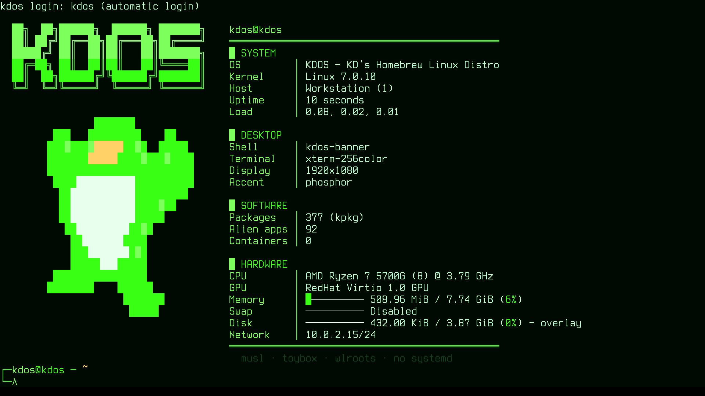

# Boot and init

This chapter follows a KDOS machine from power-on to the login prompt and names the program that
owns each step: the Limine boot loader, the kernel's early microcode loader, the initramfs and its
boot splash, the A/B root slots, `rcS` and the service scripts, and the console login that starts
the desktop. It is written for two readers: someone whose machine stops somewhere along that path
and who needs to know which program to look at, and a contributor changing the boot loader, the
initramfs, the splash, the slots, `rcS` or the login. Read
[the architecture overview](overview.md) first for where boot sits in the running system, and
[Getting started](../02-user-guide/getting-started.md) for the same path seen from the user's
side: what appears on screen and which menu entry to pick.

To diagnose a boot, read [The sequence](#the-sequence) and
[When a boot stops](#when-a-boot-stops), then go to the section for the step that failed. Several
sections are reference for contributors and change nothing about how a running machine behaves:
[Why the plate is opaque](#why-the-plate-is-opaque), [The margin ceiling](#the-margin-ceiling),
[The artwork](#the-artwork), the build checks listed in [The initramfs](#the-initramfs), and
[Tools that must be util-linux's](#tools-that-must-be-util-linuxs). After this chapter you can say
which stage a boot reached, where that stage writes its log, what each kernel command-line word
does, and how the A/B root slots decide which root to boot and when to roll back.

Terms used throughout:

| Term | Meaning |
|---|---|
| ESP | The EFI system partition: a small FAT partition the firmware reads. On an installed KDOS machine it holds the boot loader, the kernels, the boot menu and the A/B boot state, and the running system mounts it at `/boot/efi`. |
| initramfs | The small archive the kernel unpacks into memory and runs first. Its `init` script finds, unlocks and mounts the real root, then hands over to it. |
| Root slot | One of two root partitions, `a` and `b`, on a machine set up for A/B updates. One is the *active* slot, known to work; the other can hold an update on *trial*. Not the same thing as a colour [slot](../06-reference/glossary.md). |
| Live medium | The KDOS ISO, booted from a USB stick or optical disc, running from a compressed image with an in-memory (or persistent) overlay on top. |
| Splash | `kdos-splash`, the program that draws the boot animation and the stage list on the framebuffer from the initramfs until the login prompt. |
| Runlevel | The state sysvinit's `init` keeps the machine in, named in `/etc/inittab`: `3` is the running system, `S` single-user, `0` power-off and `6` reboot. Each `inittab` entry lists the runlevels it runs in, and `telinit` moves between them. |

## The sequence

| # | Stage | Run by |
|---|---|---|
| 1 | Firmware, BIOS or UEFI | The machine |
| 2 | Limine, from the ESP on UEFI or from the MBR on BIOS | The firmware |
| 3 | The kernel, with its command line | Limine |
| 4 | Early microcode load | The kernel, before any filesystem exists |
| 5 | The initramfs `init`: mounts `/proc`, `/sys`, `/dev`, `/dev/pts` and `/dev/shm`, starts the splash | The kernel |
| 6 | Device manager: `udevd`, trigger, settle | The initramfs `init` |
| 7 | Software RAID assembly (`mdadm --assemble --scan`), when `mdadm` is carried | The initramfs `init` |
| 8 | Filesystem modules: `loop`, `isofs`, `squashfs`, `overlay` | The initramfs `init` |
| 9 | A/B slot selection, when the command line names `bootstate=` | `kdos-bootctl select` |
| 10 | Volume-group activation, then the encrypted-root unlock, then activation again | `lvm`, `cryptsetup` |
| 11 | Find, check and mount the root (installed), or find the medium and build the overlay (live) | The initramfs `init` |
| 12 | `switch_root` | util-linux's `switch_root` |
| 13 | `/etc/init.d/rcS` | init (sysvinit), as its `sysinit` entry |
| 14 | The numbered service scripts ([boot order](../02-user-guide/administration.md#services)) | `rcS` |
| 15 | `kdos-bootctl mark-good` | `rcS`, last |
| 16 | The splash quits | `rcS` |
| 17 | `kdos-getty` on tty1 and tty2; `serial-getty` (`agetty`) on `ttyS0` | init, as `respawn` entries of runlevel 3 |
| 18 | `kdos-login`, which hands tty1 to `agetty` | `kdos-getty` on tty1 |
| 19 | The desktop | `~/.bash_profile` (or `~/.zprofile` for a zsh login), on tty1 only |

Step 19 is [the session](session.md). A login on tty1 reaches it without anyone typing a
command. `tty2` is a plain `agetty` and is the recovery console: a machine whose GPU driver fails to
come up still has a login prompt there. Press `Ctrl+Alt+F2` to reach it from the desktop, or
`Alt+F2` at a text console, and `Alt+F1` to come back.

## When a boot stops

The splash names each stage as it runs, so the last line it shows is the stage that stopped. The
initramfs stages are, in order: `DEVICE MANAGER`, `RAID`, `FILESYSTEM MODULES`, `BOOT SLOT`,
`VOLUME GROUPS`, `UNLOCKING`, then `ROOT DEVICE`, `MOUNTING ROOT` and `SWITCHING ROOT` on an
installed machine, or `BOOT MEDIA`, `SYSTEM IMAGE`, `OVERLAY ROOT` and `SWITCHING ROOT` on the
live medium. A stage appears only on a boot that runs it. After `switch_root`, `rcS` adds
`MOUNTING FILESYSTEMS`, one stage per enabled service script, named after the script in capitals,
and `STARTING SESSION`.

| Where it stopped | What happened | Where to look |
|---|---|---|
| Before the menu | The firmware found no boot loader | [Limine and the kernel command line](#limine-and-the-kernel-command-line) |
| An initramfs stage, then a shell | The root, the medium or the container could not be found or opened | The reason on the splash and on `tty1`, which then holds a rescue shell; the full log on the serial line when it is the console (every live entry). See [The rescue shell](#the-rescue-shell), then [Finding the root](#finding-the-root), [Unlocking an encrypted root](#unlocking-an-encrypted-root), [`blkid`](#blkid) |
| `ROOT FILESYSTEM HAS ERRORS - RUN e2fsck` | `e2fsck -p` left errors on an ext root | [Checking the root](#checking-the-root) |
| `fsck: errors left uncorrected` | A non-root filesystem has errors | `/run/kdos-fsck.log` |
| A service stage marked failed | That service script exited non-zero; up to six lines of its output are on the splash | `/run/kdos-init.<name>.log`, and `/run/kdos-svc.<name>.log` for a supervised daemon |
| A login prompt with the wrong font or colours | The console setup did not complete | `/run/kdos-getty.<tty>.log` |
| A black screen after the splash | The session did not start | Press `Ctrl+Alt+F2` (`Alt+F2` at a text console) and log in on tty2; then [The session](session.md) |

Everything the initramfs prints goes to `/dev/console`, and where that is depends on the boot (see
[the `console=` row](#command-line-parameters-kdos-reads)):

- On the live medium it is the serial port, so a machine that dies behind the splash can still be
  read from a serial line or from a virtual machine's serial output.
- On an installed machine it is the first virtual terminal, the same screen the splash draws on.
  A failure quits the splash before the rescue shell opens there, so the reason and the prompt
  are on the text console; see [The rescue shell](#the-rescue-shell).

## Limine and the kernel command line

The boot loader is [Limine](https://limine-bootloader.org/) (the `limine` port, 12.9.0), and it is
the only one. The same binary, the same configuration file and the same menu serve BIOS and UEFI,
so what a machine shows at power-on does not depend on how it started. On UEFI the firmware loads
`EFI/BOOT/BOOTX64.EFI`. On BIOS it runs the boot code in the first sector, which `limine
bios-install` writes and which finds `limine-bios.sys` by name in the root, `/boot`, `/limine` or
`/boot/limine` of a volume it can read. The live medium carries both paths. The installer asks for
that boot code on the target disk whatever the installing machine booted as, but on a GPT disk
Limine's BIOS stage needs a BIOS boot partition and the installer's layout has none, so an installed
disk starts on UEFI only; see [Known
gaps](../06-reference/known-gaps.md#an-installed-disk-starts-on-uefi-only).

`BOOTIA32.EFI` sits beside the 64-bit binary, and the two never compete. A 64-bit CPU does not
imply a 64-bit firmware: early Atom tablets and a few netbooks run this kernel and this userland
but can load only a 32-bit EFI binary. Firmware reads the one `EFI/BOOT/BOOT<arch>.EFI` it can
execute and ignores the other. The `limine` port builds both from one source
(`--enable-uefi-x86-64 --enable-uefi-ia32`). The ISO carries both under `EFI/BOOT/`, and its UEFI
El Torito image (El Torito is the specification firmware follows to find a boot image on a disc),
`limine-uefi-cd.bin`, gathers whichever EFI binaries the build produced. The
installer copies `BOOTIA32.EFI` to the ESP where it exists and warns when it does not. The cost is
about a hundred kilobytes and one more freestanding build (one with no C library, as code that
runs under the firmware needs).

An NVRAM boot entry names exactly one path, so the installer has to choose. The removable-media
fallback picks between the two binaries by itself; `efibootmgr --create` cannot, and an entry
pointing at a binary the firmware cannot load fails rather than falling through to the next
option. `kinstall` therefore reads `/sys/firmware/efi/fw_platform_size` and writes an entry
labelled `KDOS` for the matching path. A kernel that does not publish that file leaves the
installer assuming 64, which covers nearly every machine; where the assumption is wrong, a 32-bit
firmware still boots the disk through the removable-media fallback.

The entry also names a partition number. The installer reads it from the kernel's
`/sys/class/block/<node>/partition` for the ESP it actually wrote to, and never derives it from the
device name: only a wiped disk has its ESP at index 1, and an install that reuses existing
partitions uses whichever one was chosen. Where the number cannot be read, the installer writes no
entry and says so. The removable-media fallback still starts the disk, while an entry naming the
wrong partition would be a boot option the firmware cannot load.

### Where the kernel is kept

The kernel and initramfs are placed where the loader is certain to read them: on the ISO9660
filesystem for the live medium, and on the **ESP** for an installed system. Limine reads FAT and
ISO9660. It does not read most of the root filesystems the installer offers, which include xfs,
f2fs and anything under LUKS, so a kernel on the root filesystem would make booting depend on a
driver the boot loader does not have. On the medium, keeping them on ISO9660 also keeps the El
Torito ESP down to Limine's own two-megabyte image, rather than carrying the kernel and initramfs
twice.

Three programs write the loader configuration, and nothing else does:

| Writer | File | When |
|---|---|---|
| `script/phases/70_image/110_iso.sh` | `boot/limine/limine.conf` on the live medium | At build time |
| `kinstall` | `limine.conf` at the root of the installed machine's ESP | At install time |
| `kdos-bootctl` | The `/KDOS` entries of that same file, and its theme keys; plus `EFI/kdos/trial/limine.conf` during a UEFI update trial | Whenever the boot state or the accent changes; see [One kernel per slot](#one-kernel-per-slot), [One boot through BootNext](#one-boot-through-bootnext) and [Restamping an installed machine](#restamping-an-installed-machine) |

The root of the ESP is not an arbitrary location. Limine looks beside its own EFI binary first and
then at `/boot/limine/`, `/boot/`, `/limine/` and `/` on each volume, and only that last set is
searched on BIOS, so the root of the ESP is the one path both firmwares find. A second copy beside
`BOOTX64.EFI` would be the copy that goes stale. The single exception is
`EFI/kdos/trial/limine.conf`, beside a copy of the loader, which `kdos-bootctl` writes from the
root's file for the length of a UEFI update trial and deletes afterwards.

`fwupd` never touches the loader configuration. It writes to the ESP only while a firmware update
is staged: a capsule under `EFI/kdos/fw/` with `EFI/kdos/fwupdx64.efi` and a one-shot `BootNext`
entry naming it, or a capsule under `EFI/UpdateCapsule/` for firmware that reads one from disk.
The boot order is not changed, and the boot after the update is Limine's again.

An updated kernel reaches the ESP through `kdos-bootctl deploy`, which copies it into its root
slot's directory there; see [A new kernel](#a-new-kernel), after the slots are introduced.

### The menu

The menu counts down for ten seconds (`timeout: 10`), on the live medium and on an installed
system alike. Any keypress stops the countdown and leaves the menu up. The countdown is time spent
before the kernel exists, but it is what makes the recovery entries reachable, and a countdown
short enough to miss makes them unreachable on exactly the machine that needs them. Setting
`timeout: 0` does not boot at once with a menu: it boots the default entry without drawing a menu
at all, and those entries go with it.

| Live medium | Installed machine |
|---|---|
| `KDOS Live`: start from the medium | `KDOS`: start this machine |
| `KDOS Live (clean session)`: adds `nopersist`, ignoring the persistence store | `KDOS (verbose)`: `loglevel=7`, every kernel message |
| `KDOS Live (verbose)`: `loglevel=7` | `KDOS (single user)`: `loglevel=7 single`, a verbose boot (see below) |
| `Memory Test (memtest86+)`: UEFI only | `KDOS (slot <x>)`: the other root slot, when it has a root and a kernel |
| | `Memory Test (memtest86+)`: UEFI only |

The `KDOS (single user)` entry boots to runlevel `S`: `rcS` runs as on every boot, so every
enabled service starts, and then `sulogin` asks for root's password on the console, with no
gettys and no desktop. Leaving that shell continues to runlevel 3, the running system. See
[Single-user and emergency mode](#single-user-and-emergency-mode).

The memtest86+ payload is an EFI binary, so its entry carries `if_fw_type: UEFI` and is hidden on
a BIOS boot, where it could not start. The entry is left out when the payload
(`/usr/share/kdos/memtest86plus/memtest.efi`) is not installed.

The menu is drawn as a character grid in the [accent](../06-reference/glossary.md) in force (the
colour scheme the machine is set to), in Terminus `ter-i16n` (an 8x16 face in the CP437 encoding
Limine indexes by), over a dimmed full-screen backdrop. The console's own face, `ter-kdos32n`, is
not usable here: Limine reads only 8-dot-wide fonts, and only Terminus's `-i` faces are CP437, so
`script/phases/70_image/psf2limine.py` refuses both mistakes rather than converting them. See
[Theming the boot menu](../02-user-guide/theming.md#the-boot-menu-the-splash-and-the-text-consoles)
for what you can change and [the design language](design-language.md) for where the colours come
from.

`kcol_limine_conf()` in libkcolor emits the whole look, and both writers call it: the ISO step
through `kdos-bootctl theme --print`, and `kinstall` directly. One function means a USB stick and
the machine installed from it cannot show different colours. The only lines the writers own
themselves are the ones that name files rather than colours (`wallpaper`, `term_font` and
`term_font_size`), because those files are in different places for each:

| File | On the live medium | On an installed machine |
|---|---|---|
| Font | `psf2limine.py` converts `ter-i16n` in the image phase and writes `boot/limine/font.bin` straight into the ISO tree. It is not in the root filesystem. | `kinstall` copies `/boot/limine/font.bin`, or `/mnt/iso/boot/limine/font.bin` (where the initramfs mounts the medium), to `EFI/kdos/font.bin` |
| Backdrop | `/usr/share/kdos/boot/kdos-backdrop.png`, falling back to `kdos-banner.png`, copied to `boot/limine/wallpaper.png` | The same two files, which the `fs/` overlay ships in the root, copied to `EFI/kdos/wallpaper.png`, so an install run with no medium mounted still gets its artwork |

Either file missing is survivable: Limine draws its own face on a plain backdrop, and the entries
are unchanged.

### Command-line parameters KDOS reads

| Parameter | Read by | Meaning |
|---|---|---|
| `root=UUID=<fs-uuid>` | The initramfs | The filesystem to mount as root. The live medium passes `root=/dev/ram0`, which the initramfs ignores; with no `root=UUID=` it searches for the medium instead. |
| `cryptdevice=UUID=<luks-uuid>:<name>` | The initramfs | A LUKS container to open before looking for the root. `/dev/<node>:<name>` is also accepted, and an empty name becomes `kdosroot`. |
| `bootstate=UUID=<esp-uuid>` | The initramfs, for `kdos-bootctl` | Which ESP holds the A/B state file. Without it no slot selection runs. |
| `kdos_slot=a` or `b` | `kdos-bootctl select` and `mark-good` | The slot whose ESP directory this kernel came from. Every installed-machine entry carries one. |
| `nopersist` | The initramfs, live medium only | Ignore the persistence store; this session is not saved. |
| `panic=10` | The kernel | Added to the candidate's entry during a UEFI update trial, unless the command line already sets `panic=`. The kernel is built with `CONFIG_PANIC_TIMEOUT=0`, so without it a panicking kernel waits for the reset button. |
| `single` | The initramfs, handed on to init | Carried by the installed menu's `(single user)` entry. Init runs `rcS` and then `sulogin`, with no consoles and no desktop. |
| `emergency` | The initramfs, handed on to init | `sulogin` before `rcS`: only the initramfs's mounts exist. No menu entry carries it; add it in Limine's entry editor (`E` on an entry). |
| `quiet loglevel=3`, `loglevel=7` | The kernel | Normal and verbose entries. |
| `console=` | The kernel | Where kernel messages and `/dev/console` go. The last one named wins. |

The live medium's entries carry `console=tty0 console=ttyS0`, so there the last `console=` is the
serial port. Kernel and initramfs messages go to the serial line and the display shows nothing,
which is what leaves the framebuffer free for the graphical splash. An installed machine's entries
carry `console=tty0` alone, so there `/dev/console` is the first virtual terminal. Either way the
encrypted-root prompt is drawn through the splash and read from `/dev/tty1` explicitly, rather
than through `/dev/console`, and a boot the initramfs cannot finish puts its reason and a rescue
shell on `tty1` as well as on `/dev/console` ([The rescue shell](#the-rescue-shell)).

### Restamping an installed machine

`kdos-bootctl theme <accent>` rewrites the look of the boot menu and the text consoles in place:

- In `limine.conf` it touches only the keys the theme owns and leaves every entry, `cmdline`,
  `timeout`, `default_entry`, `wallpaper`, `term_font` and the A/B state alone. A restamp that
  rewrote the file from a template would discard a slot somebody is in the middle of rolling back.
  `wallpaper_style` and `term_font_scale` are among the keys it owns, so a restamp also sets the
  menu's layout. The new block lands where the first owned line was, or, in a file with none,
  immediately before the first entry, which is the only position both firmwares' parsers accept
  a global in.
- It writes the accent's sixteen console colours to `/etc/vtrgb`, which `kdos-getty` loads onto
  each virtual terminal before the login prompt. The change shows at the next login prompt.

Both writes are temporary file, `fsync`, rename, `fsync` the directory. The ESP is FAT with no
journal, and a zero-length `limine.conf` is a machine that shows no menu. An accent name that is
not one of the compiled-in schemes is refused with exit status 2.

`kdos theme` reaches this through `kdos-powerd accent`, which also writes `/etc/kdos/accent` for
the splash. A machine with no `limine.conf` at the default path (the live medium, for instance)
retints its consoles, reports that the boot menu is unchanged and exits 0; the desktop still
retints.

### Why the plate is opaque

The menu's plate (the rectangle the entries are drawn on) is opaque, and its backdrop is
stretched. Both choices are about legibility.

`term_background` carries a leading transparency byte, emitted as `00`. With a transparent plate
the artwork could be any size, but Limine prints `linux: Loading kernel …` at the terminal's own
origin the moment an entry is picked, and with no plate those lines land across the artwork. With
an opaque plate the loading text can only appear inside it. Limine's own default over a wallpaper
is `80`, half transparent, which makes the menu unreadable.

A `centered` wallpaper is drawn at its own size in the middle of the screen, which is exactly where
the menu is, so the style is `stretched`. `term_font_scale` is `1x2`: doubling both axes of an
8x16 face would fill a 1080-row screen with four entries.

No placement avoids the loading text at every resolution, which is why the plate is opaque rather
than the artwork being moved. The text's position is in pixels from the margin; the artwork's is a
fraction of a stretched wallpaper. A banner that clears the text at 1080 lines runs underneath it
at 720.

### The margin ceiling

The artwork lives in the margin above the plate, and the margin cannot grow freely. A margin that
leaves the terminal under sixteen rows makes Limine abandon the graphical terminal altogether.
At 1280x800 with these keys, a `term_margin` of 144 leaves sixteen rows and the theme applies; 152
leaves fifteen, and Limine comes up in its own font, palette and branding with no wallpaper. The
result is the absence of the whole theme rather than a degraded one, so the value has to be safe on
the smallest screen anyone boots.

A row is `term_font_size` times `term_font_scale`, 16 by 2, so the ceiling is
`(height − 512) / 2`: 144 at 800 lines, 104 at 720, 44 at 600. The shipped value is 100, which
clears 720 lines and everything above. `term_margin_gradient` is 8, a short fade at the plate's
edge that does not reach up into the artwork.

`interface_branding` is emitted **empty**, and empty is not the same as absent. The artwork is the
branding, so a value would print "KDOS" in a font directly under a picture of it; but if the key
is left out, Limine falls back to its own default and prints `Limine <version> (x86-64, UEFI)` in
its own cyan. `interface_help_hidden: yes` removes the key-help block. The countdown line still
draws in the help colour, so `interface_help_colour` is set anyway, or the countdown would be
Limine's default green under every accent.

### The artwork

The backdrop is the penguin and the wordmark, sized to fit the margin.
`src/art/kdos-splash/genbackdrop.py` lays them on a fixed near-black floor, `(10,10,9)`, in
greyscale, on a 1920x1080 canvas. It is achromatic because Limine cannot retint a wallpaper, and
`kdos-bootctl theme` rewrites text keys only: this one file sits under all eight accents, and a
green penguin would stay green under amber. Four of the generator's constants are fixed by the
constraints below, and each prevents something that would look like a rendering defect:

- **The artwork ends 6.3% of the way down the screen, because the margin is 100 pixels.** It
  starts at 0.4% and is 5.9% tall. The wallpaper is stretched, so the artwork scales with the
  screen while the margin does not; it has to clear 100 pixels on the tallest screen it will be
  seen on. 6.3% is 68 pixels at 1080 lines and 90 at 1440, the largest resolution the tree
  references, and the plate starts covering it above about 1580.
- **The captions are dropped.** At this height the two lines of small print would be three pixels
  tall; including them would cost the wordmark a third of its own height to render something
  illegible.
- **The ink is the maximum channel, not the luminance.** The wordmark is phosphor green,
  `(57,255,20)`, which Rec.601 luminance puts at 169 while the penguin's white lands at 249, so a
  plain greyscale conversion leaves the letters visibly duller than the mascot beside them.
- **The black point is 64, and that is what stops the rectangle.** The source banner carries an
  ambient green glow over its whole area: its corner pixel is `(18,64,31)`, not black, so
  composited onto the floor it would lift its own area and draw a box around itself. 64 is the
  95th percentile of the border ring. Subtracting it takes the border to exactly zero at a cost of
  2% of the strong ink.

The downscale is `BOX` (area averaging) because the wordmark is pixel art, and a photographic
filter on hard edges gives blocks of different widths with soft, jagged edges. There is no
vignette and no texture: a wordmark folded onto itself reads as grain at full size and as smudges
at a sixth of it, and a flat floor cannot band. The generator is a host script whose output,
`fs/usr/share/kdos/boot/kdos-backdrop.png`, is committed, the same arrangement `genbanner.py` and
`genlogo.py` use. Run it with `--check` to report the current file without rewriting it.

## Microcode

The kernel is built with `CONFIG_MICROCODE=y` and late loading off, so its early loader is the
only way microcode reaches the processor. That loader runs before any filesystem exists, and scans
the raw initrd for two literal paths:

```
kernel/x86/microcode/GenuineIntel.bin
kernel/x86/microcode/AuthenticAMD.bin
```

The image the boot loader hands over is therefore two archives concatenated: a plain, uncompressed
cpio containing those two files, followed by the gzipped initramfs. Three properties must hold,
and breaking any of them means microcode is silently never applied.

**Nothing in the microcode archive may be compressed**, neither the archive nor the files inside
it, whatever form the firmware package ships them in: the early loader cannot decompress. The
build takes every `microcode_amd*.bin` under `/usr/lib/firmware/amd-ucode/` as it is and expands
every `microcode_amd*.bin.zst`, concatenating one container per family into `AuthenticAMD.bin`.

**The Intel bundle is not curated.** The `intel-ucode` port builds
`/usr/lib/firmware/intel-ucode.bin` from upstream's whole set, minus the images upstream ships
separately under `intel-ucode-with-caveats/` because they need coordinated firmware support. A
per-family prune would boot on the machines it covers and leave every other one silently
unpatched.

**The Intel bundle must be consumed to exactly its last byte.** The kernel's scanner returns
nothing at all if any trailing data remains, so one stray file in the bundle means *no* microcode
is loaded, not "everything before the bad record". The port walks the records the same way when
it builds and fails rather than shipping such a bundle.

An initramfs without microcode has no symptom, because the processor keeps whatever the firmware
loaded, so the build stops when a vendor's microcode is installed and yields nothing: an empty
`intel-ucode.bin`, the `intel-ucode` package without its bundle, or an `amd-ucode/` directory with
no container in it. When a vendor's source is absent altogether, the build says so (for example
`Microcode: no amd-ucode/ — AMD CPUs will run BIOS microcode`) and carries on. `kdos doctor` (the
[health check](../04-programs/kdos-command.md#kdos-doctor)) runs the kernel's own search against
`/boot/initramfs.cpio.gz` and reports the running revision.

## The initramfs

`script/phases/70_image/090_initramfs.sh` generates it in the image phase as
`build/initramfs.cpio.gz`, and `110_iso.sh` copies that file to the ISO's `boot/` and to `/boot/initramfs.cpio.gz` in the image,
so an installed system carries it. It carries bash, GNU coreutils, grep and sed, a module set,
and the programs early boot needs. The `init` it generates is a bash script; the sections that follow this one describe
what it does, in the order it does it.

The module list decides which machines can boot at all, because a root filesystem whose driver is
missing installs perfectly and never boots again:

```
storage and buses  overlay squashfs isofs cdrom sr_mod loop sd_mod
                   ata_piix ahci libahci
                   virtio virtio_blk virtio_pci virtio_scsi
                   xhci-pci xhci-hcd ehci-pci ehci-hcd ohci-pci ohci-hcd
                   usb-storage uas
disk transports    vmd mmc_block sdhci-pci sdhci-acpi cqhci rtsx_pci_sdmmc
                   hv_storvsc xen-blkfront vmw_pvscsi megaraid_sas mpt3sas
the ESP            vfat nls_cp437 nls_iso8859-1
root filesystems   xfs f2fs
LUKS               dm-crypt dm-mod aesni-intel xts crypto_null algif_skcipher
software RAID      md_mod raid0 raid1 raid10 raid456 dm-raid
LVM targets        dm-snapshot dm-thin-pool dm-cache dm-cache-smq dm-writecache
```

Each module's dependencies are copied with it, a compressed module is decompressed on the way in,
and a module built into the kernel is skipped. ext4, btrfs and xfs are built into the kernel the
`linux` port produces (`kdos.config` sets `CONFIG_EXT4_FS`, `CONFIG_BTRFS_FS` and `CONFIG_XFS_FS`
to `=y`); f2fs is a module, and is the entry here that an f2fs root depends on. xfs stays in the list, where
its copy is a no-op on this kernel, so that a kernel with xfs as a module still boots an xfs root.
**Every filesystem the installer offers has to be in this list**: `ki_filesystems[]` in the
installer is what offers the choice, and this list is what makes the choice bootable. **Every disk
transport the installer installs to has to be reachable here too**, for the same reason: a disk
the installer can see but this initramfs has no driver for takes an install and then never finds
its root. NVMe behind Intel VMD (RST), eMMC and SD cards (which the installer classifies as `mmc`),
Hyper-V, Xen and VMware guests' disks, and MegaRAID and mpt3sas controllers are modules on this
kernel, and each brings its dependencies (`mmc_core`, `hv_vmbus` and the rest).

- **LUKS ciphers.** These are the ones a LUKS2 default header uses. They are carried
  unconditionally because they are small, and on a kernel that has them built in the copy is a
  no-op. The generic AES, SHA-256 and SHA-512 code is built into this kernel and has no module
  to name.
- **RAID personalities.** They are listed individually because `md_mod` loads none of them. A
  machine whose data disks are an array needs them before udev settles; without `md_mod` the
  members are bare disks with a superblock nobody reads, which looks like an empty drive rather
  than a missing module.
- **LVM targets.** These are the ones a volume group can hold beyond the linear target built into
  `dm-mod`: a thin volume, a cached or write-cached one, a snapshot. A group holding one activates
  only with its target loaded.

The list is also written to the image as `/boot/initramfs.modules`, which is what a later kernel's
initramfs is built from; see [A new kernel](#a-new-kernel).

The programs carried, and the rule each follows:

| Program | Rule |
|---|---|
| `cat`, `chmod`, `cut`, `ls`, `mkdir`, `mknod`, `seq`, `sleep` | GNU coreutils: what `init` runs. The build stops if one is missing or its `--version` names no GNU package. |
| `cp`, `mv`, `rm`, `ln`, `rmdir`, `head`, `tail`, `wc`, `stat`, `df`, `dd`, `sync`, `uname`, `readlink`, `touch`, `sort`, `tr`, `grep`, `sed` | GNU coreutils, grep and sed, for the [rescue shell](#the-rescue-shell), under the same check. |
| `switch_root`, `mount`, `umount`, `losetup`, `dmesg`, `setsid` | Always util-linux's: the build stops unless each one's `--version` names util-linux. See [`switch_root`](#switch_root). |
| `blkid` | Always util-linux's, under the same check; see [`blkid`](#blkid). |
| `kdos-splash` | Carried with `/usr/share/kdos/splash.psf` when installed; otherwise the build warns and the machine boots without a splash. |
| `udevd`, `udevadm`, `kmod` (as `modprobe`, `insmod`, `depmod`) | Always, with the udev rules from `/usr/lib/udev` and `/etc/udev`. |
| `mdadm` | When installed. |
| `e2fsck` | With `libext2fs`, `libcom_err` and `libe2p`, or not at all. |
| `kdos-bootctl` | With `libpng16`, or not at all (below). |
| `cryptsetup` | With its libraries, only when installed. |
| `lvm`, `dmsetup`, `thin_check`, `cache_check` | Whenever lvm2 is installed (below). |

`cryptsetup` and its libraries are carried only when they are installed, and the build says so
when they are not. A half-carried `cryptsetup` would fail at the passphrase prompt rather than at
build time, which is the wrong place to find out.

`lvm` and `dmsetup` are carried whenever lvm2 is installed, and `cryptsetup` and `parted` both
depend on lvm2, so every image with either of them has it. They are copied to `/usr/sbin`, the paths
lvm2's udev rules name, rather than to `bin/`. The rules travel with the rest of `/usr/lib/udev`,
and `95-dm-notify.rules` runs `/usr/sbin/dmsetup udevcomplete` for every device-mapper change.
`lvm`, and `cryptsetup` opening a container, wait for that call with no timeout, so a `dmsetup` the
rule cannot find would hang the boot at the unlock or the activation with nothing on screen.

Their libraries are not listed by hand. `copy_closure` reads each program's `NEEDED` entries with
`readelf` and copies the libraries they name, and theirs, from `/usr/lib` or `/lib`. For `lvm`
that is libdevmapper, libdevmapper-event, libaio, libblkid, libudev, readline and libnvme with what
libnvme links. `thin_check` and `cache_check` come with them, as argv[0] links to
thin-provisioning-tools' single binary, `pdata_tools`, which is copied with its closure; `lvm` runs
the matching one before it activates a thin pool or a cache, and refuses the volume without it. A
generated `etc/lvm/lvm.conf` names those two paths and nothing else.

The build stops, naming the problem, when:

- lvm2 is installed and `lvm`, `dmsetup`, `thin_check` or `cache_check` is missing;
- a udev rule names `dmsetup` or `lvm` anywhere but `/usr/sbin`;
- a library in a program's closure is installed nowhere;
- a GNU or util-linux program above is missing, or its `--version` does not name its package;
- no working `readelf` is found. `readelf`, or `llvm-readelf` in its place, must find libblkid
  among `blkid`'s `NEEDED` entries. A missing reader would fail inside a command substitution,
  which `set -e` does not catch, and every program would be copied without its libraries;
- any program in `bin/` or `usr/sbin/`, or any library in `lib/`, names a library the initramfs
  does not carry. Without this check the failure is a kernel panic (`Attempted to kill init`) or a
  tool that says "not found" at the one moment it is needed.

`kdos-bootctl` is carried with its libraries or not at all, and it needs `libpng16`.
`/usr/bin/kdos-bootctl` is a symlink to `/usr/sbin/ksvc` (the multi-call binary that also supervises
the [daemons](../04-programs/daemons.md)), which links libpng for `kdos theme`'s wallpaper retint.
libpng16 is carried beside it (libz is already there and musl's libm is inside libc, so the set is
closed), and the copy is skipped entirely when libpng is absent. A `kdos-bootctl` that cannot run would mean A/B slot selection never happens, and the
machine would look like one whose slot was never marked good rather than one missing a library.

The packed file is the microcode cpio, when there is any microcode, followed by the whole tree as a
`gzip -9` archive in newc, the portable cpio format the kernel unpacks; see [Microcode](#microcode).
Both archives are written by GNU cpio from a byte-sorted file list with `--reproducible`, which
records no number for the device a file is stored on, numbers the inodes in archive order from 0
and gives every directory a link count of 2, so the archive does not depend on the filesystem the
tree is staged on. It still records each file's modification time, owner and mode, and the step
resets none of them, so two builds of the same tree pack to the same bytes only when every staged
file carries the same times. The gzip header holds no time, because gzip reads the archive from a
pipe. The tree carries no `System.map` (`depmod` reads the build's
copy in `/boot`) and no `hwdb.d` sources: udev reads only a compiled `hwdb.bin`, and the tree
carries none.

### The rescue shell

Every way the initramfs can fail to finish (no medium, no root, no `/sbin/init` on it, a container
that will not unlock, a `system.sfs` that will not mount) ends in one helper, `rescue`. It:

1. prints the reason on `/dev/console`;
2. sends it to the splash as a detail line and quits the splash, which hands the framebuffer back;
3. writes it to `tty1`, where fbcon takes the screen over at the first write and the keyboard is,
   and opens a shell there in its own session, with `tty1` as its controlling terminal;
4. becomes the shell on `/dev/console`, so the serial line keeps a shell beside the log it has been
   reading.

When `/dev/console` is itself a virtual terminal (an installed machine's entries carry
`console=tty0` alone), there is one screen and one shell. The shell on `/dev/console` is process 1:
leaving it panics the kernel with `Attempted to kill init`. The initramfs carries no `reboot`;
`sync; echo b > /proc/sysrq-trigger` restarts the machine from either shell.

## The splash

`kdos-splash` draws a CRT power-on animation directly to `/dev/fb0`, with glyphs scaled up from
its own font (`/usr/share/kdos/splash.psf`), then lists the boot stages under a progress bar. It
is a static binary of about 1,200 lines of C, and every failure path exits without drawing: a
boot animation must never be able to stop a boot. The initramfs starts it before the device
manager, and it runs until `rcS` quits it just before the login prompt.

| Command | Effect |
|---|---|
| `kdos-splash run` | Draw, and read commands until told to quit |
| `kdos-splash step "NAME"` | Begin a stage |
| `kdos-splash ok`, `kdos-splash fail` | Close the current stage |
| `kdos-splash msg "text"` | Show a plain line |
| `kdos-splash detail "text"` | Show a line of failure detail |
| `kdos-splash total N` | Add N to the expected number of stages |
| `kdos-splash accent NAME` | Repaint in that accent; an unknown name changes nothing |
| `kdos-splash quit` | Run the power-off animation, then exit |
| `kdos-splash preview WxH T out.ppm` | Render the frame T seconds into the power-on animation, with a fixed set of sample stages, to a PPM file without a framebuffer; a T past the animation gives the settled picture |

The kernel is built with deferred framebuffer-console takeover
(`CONFIG_FRAMEBUFFER_CONSOLE_DEFERRED_TAKEOVER`), so the text console does not claim the
framebuffer until a glyph is printed on a virtual terminal, and a process is free to draw on it.
Three facts constrain the splash.

Only a printed glyph ends the deferral; escape sequences and spaces do not. The splash writes a
clear-and-hide-cursor sequence to `/dev/tty0`, which is escape sequences alone, so the splash
itself never ends it. Which glyph does depends on where `/dev/console` is:

- **On the live medium** (`console=tty0 console=ttyS0`), the initramfs and `rcS` print on the
  serial line, and the deferral lasts until `kdos-getty` prints its glyph on `tty1` after the
  splash has quit (measured at 5 to 21 seconds into boot). The splash's frames are on screen
  before that on the rig's virtio-gpu, whose framebuffer is shown without the takeover.
- **On an installed machine** (`console=tty0` alone), the initramfs's first line,
  `KDOS Init Starting...`, is printed on the screen, and the console takes the framebuffer over
  about a millisecond after `/init` starts, before the splash has started. From then on every
  line the initramfs and `rcS` print is drawn by the console on top of the splash; see
  [Known gaps](../06-reference/known-gaps.md#on-an-installed-machine-the-boot-messages-are-drawn-over-the-splash).

Memory-mapped writes need an explicit flush. They reach the display only when the deferred I/O
worker gets round to it, so each frame ends with a pan-display call to the offset it is already
at.

The process survives `switch_root` with a ghost root. It is never `chroot`ed, so afterwards its
`/` is the deleted initramfs root. Open file descriptors keep working, which is how one process
spans both halves of boot, but every path it resolves *by name* afterwards points into the ghost.
Commands reach it through a FIFO, `/dev/.kdos-splash`, which survives because `/dev` is moved into
the new root rather than remounted. The `quit` client therefore detects the running splash by
opening the FIFO for writing, which fails with `ENXIO` once no reader is left, and does the
cleanup itself from the real root.

The quit is synchronous: `kdos-splash quit` returns only once the splash has stopped drawing, or
after two seconds. A client command sent when no splash is running succeeds and does nothing, so
`rcS` and the initramfs call it unconditionally.

The splash starts in the default accent, because no root filesystem exists when the initramfs
starts it. As soon as `/etc` is readable, `rcS` reads `/etc/kdos/accent` and sends `accent`, so
the splash repaints into the machine's own scheme before the first service runs.

Adding a stage is one line on either side: a step-and-ok pair in the generated init, or in `rcS`,
which already wraps every service script in one.

The progress total is additive: each part of boot adds its own stage count as soon as it knows
it, so `done == total` happens at every boundary between parts. Until the first total arrives the
bar sweeps back and forth. The bar stops one segment short of full until `quit` arrives, so it
never shows 100% before the boot has finished.

To work on the artwork without booting, render a frame to a PPM file:

```sh
kdos-splash preview 1280x800 0.35 out.ppm
```

## A/B slot selection

A machine set up for A/B updates has two root partitions, a state file on the ESP, and a boot that
can change its mind. The state file is `EFI/kdos/bootstate` on the ESP
(`/boot/efi/EFI/kdos/bootstate` on the running system):

```
slot_a   = <filesystem uuid>
slot_b   = <filesystem uuid>
crypt_a  = <luks uuid>      the container that filesystem is inside, or empty
crypt_b  = <luks uuid>
active   = a                the slot known to work
try      = b                a candidate, or empty
attempts = 1                how many boots it has left
bootnext = yes              tried through UEFI BootNext, or empty
```

`kinstall` writes the first version whenever the install has an ESP: `slot_a` and `crypt_a`
filled in, `active = a`, no candidate. Slot B is described later with
`kdos-bootctl set-slot b <uuid> [<luks-uuid>]`, and `kdos update apply` installs into it, deploys
its kernel and calls `try`. Nothing in KDOS creates or first populates slot B's partition; see
[Known gaps](../06-reference/known-gaps.md#boot-and-updates).

In the initramfs, when the command line names `bootstate=UUID=`, the init loads `vfat`, waits up
to ten seconds for that ESP to appear, mounts it at `/esp`, and asks `kdos-bootctl select` which
root to boot. The answer replaces the command line's `root=`. A state file that cannot be read, or
an ESP that cannot be found, leaves the command line's `root=` in force, and the `BOOT SLOT` stage
still closes as passed.

### `kdos-bootctl`

`kdos-bootctl` is one of the names of the `ksvc` multi-call binary from `kdos-tools`. Its verbs:

| Command | What it does |
|---|---|
| `kdos-bootctl status [--json]` | Print what the state file says |
| `kdos-bootctl set-slot <a\|b> <uuid> [<luks-uuid>]` | Record where a slot's filesystem is, and which container it is inside |
| `kdos-bootctl crypt <fs-uuid>` | Print the container UUID that filesystem is inside, for the initramfs |
| `kdos-bootctl try <a\|b> [n]` | Put that slot on trial: one boot through UEFI `BootNext`, or `n` boots led by the menu where there is no `BootNext` (default 3, minimum 1) |
| `kdos-bootctl deploy <root> [<a\|b>]` | Put that root's kernel and initramfs in its slot's directory on the ESP |
| `kdos-bootctl select [<a\|b>]` | Decide which root to boot and spend an attempt (run by the initramfs); the argument is the entry's `kdos_slot=` |
| `kdos-bootctl mark-good` | Confirm that this boot worked (run at the end of `rcS`) |
| `kdos-bootctl theme <accent>` | Repaint the boot menu and the text consoles in that scheme |
| `kdos-bootctl theme --print [<accent>]` | Print the menu's theme block to standard output |
| `kdos-bootctl palette [<accent>]` | Print that scheme's `setvtrgb` table to standard output |

Environment variables point it at files other than the real ones, which is how the selftest
exercises it against fixtures without touching the machine running it:

| Variable | Default | Stands in for |
|---|---|---|
| `KDOS_BOOTSTATE` | `/boot/efi/EFI/kdos/bootstate` | The state file |
| `KDOS_LIMINE_CONF` | `/boot/efi/limine.conf` | The boot menu |
| `KDOS_VTRGB` | `/etc/vtrgb` | The console palette |
| `KDOS_EFIVARS` | `/sys/firmware/efi/efivars` | The firmware variables. With `KDOS_BOOTSTATE` set to anything else and this unset, no firmware variable is written. |
| `KDOS_CMDLINE` | `/proc/cmdline` | The kernel command line. With `KDOS_BOOTSTATE` redirected and this unset, no `kdos_slot=` is read. |
| `KDOS_ESP_DISK` | Read from the mount table and `/sys/class/block` | `<image>:<partition>`, the disk and partition number of the ESP |

### Counting and confirming

The counting lives in the initramfs, and that placement is the design. `rcS` would be the wrong
place: a kernel that boots into a wedged userland must still spend an attempt, and the `rcS` in
that userland never runs to say so. Limine has no boot counting of its own, so the count is kept in
the state file. `kdos-bootctl select` decides and decrements in one step, before anything is
mounted, and prints the UUID to boot:

| State | `select` does |
|---|---|
| No candidate | Boots the active slot |
| A candidate with attempts left | Spends one and boots the candidate |
| A candidate with no attempts left | Rolls back: forgets the candidate and boots the active slot |

`kdos-bootctl mark-good` is the other half. It runs at the *end* of `rcS`, after every service
that was going to fail has had its chance. A bad update therefore rolls itself back with no help:
on UEFI after its one boot, on BIOS after its allotted number. It confirms a candidate only on the
candidate's own kernel: when the command line's `kdos_slot=` names another slot, the candidate's
kernel never ran, and `mark-good` rolls it back instead. A command line with no `kdos_slot=` is
taken as the candidate's. On a machine with no boot state `mark-good` does nothing, silently.

`try` picks between the two kinds of trial. Where the firmware has variables, it writes a UEFI
`BootNext` request and the candidate gets one boot; see
[One boot through BootNext](#one-boot-through-bootnext). A BIOS boot has no such request, and
neither does a UEFI machine where the request cannot be written; there the menu leads with the
candidate for `try`'s count of boots.

The state file lives on the ESP, which is FAT and has no journal. A torn write there does more
than fail an update: it leaves the machine unbootable, because the initramfs cannot tell which
slot to boot. So every write is temporary file, `fsync` the **file**, rename, then `fsync` the
**directory**. The directory `fsync` is the step most often left out, and without it the rename
can be lost while the data survives.

A state file that does not parse is treated as absent, never as partial. Absent means "use the
`root=` the command line already carries", which is what a single-root machine does anyway. A
`try` pointing at a slot with no root, or at the active slot, is refused rather than recorded. An
unknown key is skipped, and a missing `crypt_a` or `crypt_b` reads as a slot with no container.

### A slot knows its own container

`slot_a` names a **filesystem** and `crypt_a` names what that filesystem is inside. Keeping the
two apart is what lets A/B work with encryption. On an encrypted machine the root filesystem lives
in a LUKS container, and the kernel command line can name exactly one `cryptdevice=`. Two slots
inside two containers cannot both be named there, so each slot's container is recorded in the
state file and the initramfs asks for it *after* `select` has chosen:

```sh
SEL=$(kdos-bootctl select "$BOOT_SLOT")    # the filesystem, and one attempt spent
SLOT_CRYPT=$(kdos-bootctl crypt "$SEL")    # its container, if it has one
```

`crypt` is keyed by the filesystem UUID rather than by a slot name, so nothing has to be carried
between the two calls. `select` may have rolled back, and asking "which slot did that turn out to
be" would be a second decision that could disagree with the first. `crypt` spends no attempt. Both
reads happen while the ESP is still mounted at `/esp` in the initramfs; the second reads the file
the first just wrote. The ESP is then unmounted at once, because the real root mounts it again at
`/boot/efi`.

A slot that names no container leaves `cryptdevice=` exactly as the command line set it, which
covers every unencrypted machine and every machine whose two slots share one container. When a
slot does name one, the initramfs opens it under its own mapper name, `kdosroot`, never a name
from the state file: only one container is open at a time there, so a per-slot name would
disambiguate nothing, and a name read out of a file on the ESP is a name somebody can edit into a
path.

Without this split, selecting slot B would unlock slot A's container and then look for B's
filesystem inside it. There is nothing there, and the failure would read as a corrupt filesystem
rather than as a lookup that was never made. For the same reason slot selection runs before the
unlock in the init, never after it.

### One kernel per slot

Each slot boots the kernel in its own ESP directory, and the modules for that kernel exist only in
that slot's root:

```
EFI/kdos/a/vmlinuz              slot A's kernel
EFI/kdos/a/initramfs.cpio.gz    and the initramfs built with it
EFI/kdos/b/...                  slot B's, once an update has deployed it
EFI/kdos/bootstate              the state file above
```

Limine chooses the kernel before anything of KDOS's runs, and has no boot counting, so the menu is
part of the state. `kdos-bootctl` regenerates the `/KDOS` entries of `limine.conf` on every change
(`set-slot`, `try`, `deploy`, `select`, `mark-good`) and writes the file only when the text
differs:

| Entry | Boots |
|---|---|
| `/KDOS`, `/KDOS (verbose)`, `/KDOS (single user)` | The slot an unattended boot must reach: the active slot, except during a menu-led trial, where it is the candidate while it has attempts left |
| `/KDOS (slot <x>)` | The other slot, when it has a root and a kernel |

The first entry's comment says which: `Start this machine (slot a)`, or `Try the update in slot b`
during a menu-led trial. The `(slot <x>)` entry's comment reads
`The confirmed root: picking it abandons the update` during a menu-led trial,
`The update on trial: one boot, then the confirmed root again` during a `BootNext` trial, and
`The other root, for one boot: nothing is confirmed` otherwise. `default_entry` points at the
first `/KDOS` entry. Every other line of the file (the theme, the timeout, memtest86+) stays where
it is. The command line comes from the first `/KDOS` entry: `root=` and `kdos_slot=` are set per
slot, the verbosity per entry, and every other word carries over, including anything you added by
hand. Nothing is written when the file has no `/KDOS` entry to learn a command line from, when no
slot has a directory of its own, or when the slot to lead with has no kernel.

Every entry carries `kdos_slot=<x>`, and the initramfs hands it to `select`. That is how a
hand-picked entry is recognised: its slot is not the one the menu leads with. It boots its own
slot and no other, because the running kernel is that slot's.

- **Picking the confirmed slot while a candidate is on trial** abandons the candidate. On BIOS
  that entry is the way back from a candidate kernel that dies before the initramfs can count
  anything.
- **Any other hand-picked entry** is one boot of that root. No attempt is spent and nothing is
  confirmed, except a candidate picked after its last attempt, which is still the candidate and is
  confirmed by `rcS` as usual.

In a menu-led trial, spending the last attempt moves the menu's lead back to the active slot. A
candidate that fails that boot is therefore rolled back by the next boot of the confirmed slot's
own kernel, with no reboot in between.

`try` refuses a slot that has no kernel on the ESP once any slot has a directory of its own. The
menu could not lead with it, so the confirmed slot's entry would boot, and `select` would read that
as a hand pick and abandon the candidate.

A menu whose entries boot a flat pair, `EFI/kdos/vmlinuz` and `EFI/kdos/initramfs.cpio.gz`, has no
per-slot directory, and either slot boots that pair. `kinstall` writes slot A's pair into
`EFI/kdos/a/`, so only an ESP set up some other way has a flat one. `kdos-bootctl` leaves a menu
with no per-slot directory exactly as it is. A slot without a directory of its own boots the flat
pair, and the pair is deleted once no entry names it. The next `kdos update` of each slot therefore
gives that slot its own directory.

The init inside an initramfs is the image's, and a `linux` update only appends modules to it. A
slot's init, and the `kdos-bootctl` copied beside it, are replaced only when that slot itself is
updated; no update rewrites the init of a slot it is not installing into. A confirmed slot
therefore runs the pair it was installed with until its own next update, and that pair is the one
that carries out a rollback. Two consequences follow:

- `mark-good` regenerates the menu on every boot, confirmed or not, so a menu left leading with the
  wrong kernel is corrected on the first boot that reaches the end of `rcS`.
- If the menu still leads with a candidate kernel that dies, pick the confirmed slot's
  `KDOS (slot <x>)` entry by hand. That entry boots the slot's own kernel and root.

Two kernels and two initramfs images fit many times over in the 512 MiB ESP `kinstall` creates.
An install that reuses a smaller ESP gets a warning when there is no room left for a second
kernel.

### A new kernel

The `linux` package (kernel 7.2.11) installs its kernel as `/boot/vmlinuz-kdos`. Nothing boots
that file until `kdos-bootctl deploy` copies it into its slot's directory on the ESP. Each root
slot boots its own kernel from `EFI/kdos/<slot>/`, because a kernel's modules exist only in the
root it was installed into.

The package's postinstall builds the new kernel's initramfs into the same root, as
`/boot/initramfs-kdos.cpio.gz`. It is the image's own `/boot/initramfs.cpio.gz` with one more
archive appended:

- The base carries the microcode, which the early loader finds only at the very start of the file,
  and the `init` script.
- The appended archive carries the new kernel's copies of the modules listed in
  `/boot/initramfs.modules` (the list `090_initramfs.sh` used, written beside the image's
  initramfs) and their dependencies. A root with no such list gets the set the base archive itself
  carries: every module under its `lib/modules/`, found by walking past the uncompressed microcode
  archive to the compressed part.

The kernel unpacks concatenated archives into one tree, and the init's `modprobe` looks under
`uname -r`, so it finds the new set. The init itself is therefore always the one the image
shipped. If the build fails, the postinstall removes the previous `/boot/initramfs-kdos.cpio.gz`
too, since it belongs to the kernel just replaced, and a `deploy` of that root is then refused (see
below) until one is built. `110_iso.sh` deletes `/boot/initramfs-kdos.cpio.gz` from the image, so an
ISO carries only the kernel and initramfs built together.

Who deploys depends on the root the package went into:

| Installed into | Deployed by | When |
|---|---|---|
| The running system | The postinstall, with `kdos-bootctl deploy /`, when `/boot/efi` is mounted | At once; the next boot runs the new kernel |
| The inactive slot | `kdos update apply`, with `kdos-bootctl deploy <mount> <slot>` | After every package of the run is in, before `try` |

`deploy` behaves as follows:

- It writes the initramfs and then the kernel, each beside the old file, flushed and renamed over
  it, so the directory never holds a new kernel beside an initramfs without its modules.
- It refuses before writing anything when the ESP cannot hold both files.
- It takes `/boot/initramfs-kdos.cpio.gz` where the postinstall wrote one, and the image's
  `/boot/initramfs.cpio.gz` otherwise. `kinstall` makes the same choice for slot A.
- It refuses an initramfs that holds module trees for other kernels and none for this kernel's
  version, and writes nothing. That init could not load `vfat` to read the boot state, so it would
  count no attempt and never roll back, and it could not mount a root on xfs, f2fs, LUKS or md.
  The slot keeps the kernel it had, and `kdos update apply` does not try it. An initramfs with no
  module tree at all passes, as does one that cannot be read.
- On a machine with no boot state it writes into the directory that the first `/KDOS` entry's
  `path:` names: `EFI/kdos/a/` on anything `kinstall` wrote, or the flat `EFI/kdos/` on a menu
  whose entries boot the flat pair.

In every root, the postinstall keeps the module tree of every kernel on the ESP (it reads each
version out of the header of the kernel image file, the bzImage) as well as the running kernel's,
and removes the rest. Until a root's own kernel is deployed, the next boot of that root runs one of
those kernels, and a root stripped of their modules would boot with no GPU, network or sound driver.

### One boot through BootNext

A candidate kernel that panics or hangs before its initramfs runs cannot spend an attempt, so a
menu that leads with it would boot it again after every reset. On UEFI the menu therefore never
leads with a candidate. `try` leaves `default_entry` on the confirmed slot and asks the
**firmware** for one boot of the candidate instead:

```
EFI/kdos/trial/BOOTX64.EFI      a copy of EFI/BOOT/'s loader (BOOTIA32.EFI on 32-bit firmware)
EFI/kdos/trial/limine.conf      limine.conf, with default_entry on /KDOS (slot <x>)
Boot####  "KDOS update trial"   a load option starting that loader, not in BootOrder
BootNext  = ####                one boot of it
```

`try` writes the state and the trial menu before `BootNext`, so the firmware is never asked for a
boot whose menu does not exist yet. Limine reads the `limine.conf` beside its own EFI binary before
any other, so the trial copy sees the trial menu and every other boot sees the root's. The firmware
deletes `BootNext` before it starts the loader, so whatever happens to that boot (a panic, a hang
and the reset button, a userland that never reaches `mark-good`), the next boot starts `EFI/BOOT/`
and the confirmed slot. While the candidate is on trial, its entry in both menus carries
`panic=10`, unless the command line already sets `panic=`: the kernel is built with no panic
timeout, and without the word a panicking candidate waits for the reset button.

`select` sees the rest. The candidate's own entry spends its one boot; any other entry while a
candidate is on trial is the fallback boot, and rolls it back. `mark-good` on the candidate's boot
makes it the active slot, and only then does it lead the menu. Every `mark-good` also deletes the
`Boot####` option and any `BootNext` still naming it, and every state that is not a pending trial
deletes `EFI/kdos/trial/`.

The option is written through `efivarfs`, which `rcS` mounts, rather than by `efibootmgr`. It has
a fixed shape: the ESP's partition entry, read from the GPT itself (or from a primary MBR entry),
and a path `kdos-bootctl` chose. Its number is the lowest one no `Boot####` uses, or the one
already carrying the description.

Where the request cannot be made (no firmware variables, which is every BIOS boot; no per-slot
directory to build a trial menu from; or a firmware that refuses the write), `try` says so and
falls back to the menu-led trial. There, a kernel that dies before its initramfs is recovered by
hand, by picking the confirmed slot's `/KDOS (slot <x>)` entry.

## Activating volume groups

A root on an LVM logical volume boots with the ordinary command line: `root=` names the UUID of
the filesystem on the volume, as it would for a partition. The generated init activates volume
groups before it looks for that UUID, because a filesystem on a logical volume has no device node
until its group is active.

It activates on each side of the unlock, because LVM and LUKS stack both ways. A volume group
inside a container exists only after the unlock, and a container on a logical volume needs its
group active before the unlock. It activates again on each pass of the ten-second wait for the
root, so a physical volume on a disk that enumerates late still brings up its group before the
wait gives up.

Each activation first asks `blkid -t TYPE=LVM2_member` for the physical volumes, and runs
`lvm vgchange -aay --sysinit` only when that set is not empty and differs from the set it last
activated. So:

- A disk boot without LVM costs one `blkid` per call and never starts `lvm`.
- A live boot, which has neither `root=UUID=` nor `cryptdevice=`, makes no call at all; its groups
  are activated by `03_lvm` after `rcS` starts.
- A failed activation marks the `VOLUME GROUPS` stage failed on the splash and the boot goes on. If
  the root was in that group, the root lookup reports it missing.

`--sysinit` turns off dmeventd monitoring, background polling and locking failures, none of which
an initramfs can provide. The carried `lvm.conf` names `thin_check` and `cache_check` and nothing
else, so every other setting is the compiled default and every group found is activated. The
groups stay active across `switch_root`, and `03_lvm`'s own `vgchange` leaves them as they are.

A root on a thin or a cached volume boots like any other. The first call that finds a physical
volume loads the thin, cache, write-cache and snapshot targets before it runs `lvm`, because a
group holding such a volume activates only with its target present, and `lvm`'s own module
loading uses whatever `modprobe` path its configure step found at build time. `lvm` then runs
`thin_check` or `cache_check` on the pool's or the cache's metadata before activating it.

The installer creates this layout on its erase plan and offers an existing logical volume as the
root on its reuse plan; see [kinstall](../04-programs/kinstall.md#a-root-on-lvm). Either way
`root=` is the filesystem's UUID and nothing on the command line names LVM. Under encryption the
installer puts the group inside the container, so the activation after the unlock is the one that
finds it.

## Unlocking an encrypted root

The kernel command line carries `cryptdevice=UUID=<container>:<name>`, using Arch Linux's syntax
because it is the one people already know. Two different UUIDs are involved: `cryptdevice=` names
the LUKS container, and `root=` names the filesystem inside it, which does not exist until the
container is open. `kinstall` writes both, with the name `kdosroot`. The generated init unlocks
before it looks for a filesystem for that reason. It waits up to ten seconds for the container's
device to appear, and fails the stage when the initramfs carries no `cryptsetup`.

The prompt is designed around three facts:

- It draws through the splash, not on `/dev/console`. On an installed machine, the only place the
  unlock runs, `/dev/console` is the first virtual terminal, and the splash owns that screen's
  framebuffer: a prompt printed there would be hidden under the splash or fight it for the screen.
- It reads keystrokes from `/dev/tty1`, which is where the keyboard is.
- It feeds the passphrase to `cryptsetup` on standard input, never as an argument:
  `/proc/<pid>/cmdline` is readable by every process for the life of the process.

The splash shows `PASSPHRASE FOR <name> (attempt N of 3)`, then `UNLOCKED` or `WRONG PASSPHRASE`.
After three wrong attempts the boot drops to a shell rather than into a reboot loop. There is no
per-keystroke feedback, because the splash owns the framebuffer and the shell owns the terminal;
nothing appears as you type. Once the container is open, the init waits for udev to settle and
runs a second volume-group activation, so a group inside the container is found.

## Finding the root

On an installed machine (the command line names `root=UUID=`), the init asks `blkid` for the root
UUID once a second for up to ten seconds, activating any volume group that has appeared in between.
On the live medium it rescans `/dev/sr* /dev/sd* /dev/vd* /dev/nvme* /dev/mmcblk*` every 100 ms,
for up to ten seconds from the start of the scan (counted on the uptime clock), and uses the first device that
mounts as ISO9660 and holds `system.sfs`. Neither waits before its first attempt: udev has already
settled by then, so on a machine whose medium is already enumerated the first pass succeeds and
costs nothing. The ten-second bound covers the slow cases, such as a USB stick or a device behind a
bridge. The medium is found on the whole-disk node, which is why the ISO keeps its ISO9660
filesystem at sector 0.

Every pass of the live scan walks every device class again, because the first node to answer is
not always the one holding the medium, and a class that has not appeared yet must still get its
chance. A device that mounts is inspected only once, though: a filesystem without `system.sfs` on
it will not grow one, so it is remembered and skipped, and only nodes that have not mounted yet are
retried. That is one mount and unmount for a wrong disk across the whole scan, rather than one per
pass.

`/mnt/iso` is the only mount point the scan has, so the unmount is checked. A mount point left
busy would take a second filesystem stacked on top of it and every later test would read the wrong
one, so a failed unmount stops the scan with `Cannot release /mnt/iso after <dev>`. Only the first
pass reports each device it tried; a hundred repetitions of the same two lines would bury the
message that explains a failed boot.

When the root, the medium or `/sbin/init` on it cannot be found, the init marks the stage failed on
the splash and starts a shell on `/dev/console`. Before `switch_root` it moves `/dev`, `/proc` and
`/sys` into the new root. The live path also stops the initramfs's `udevd` before `switch_root`;
the installed path does not, and `01_udev` starts a `udevd` from the real root either way.

## The live medium and persistence

On the live medium the init mounts `system.sfs` read-only through a loop device and puts an
overlay on top of it as the new root. `system.sfs` is the whole root filesystem, compressed by
`mksquashfs` in the image phase (`110_iso.sh`) with zstd at level 15 unless `KDOS_ISO_COMP` names
another codec, with the pseudo-filesystem mount points recreated empty. The
contents of `/var/cache` and `/var/log` are left out, and both directories are recreated empty too,
because a daemon makes its own directory under them with a single `mkdir` that needs the parent.
The overlay's writable upper layer decides whether the session survives a power-off:

- A filesystem labelled `KDOS_PERSIST` is used as the upper layer when one is present, in `upper/`
  and `work/` directories on it. `kdos persist` creates such a store, as an ext4 partition in the
  free space after the image. The label is looked up once, right after the medium is found, with
  no wait: a store on a device that enumerates later, such as a second USB stick, is not seen
  and the session runs in RAM.
- With no store, the upper layer is a tmpfs and the session is gone at reboot.
- `nopersist` on the command line (the menu's `KDOS Live (clean session)` entry) ignores the store.
  That entry exists so a store holding a change that stops the desktop coming up can be bypassed
  without taking the stick to another machine.

The store must support extended attributes, hard links and file types in directory entries, so a
store on vfat, exfat, ntfs, iso9660 or squashfs is refused by name. Any failure with the store
(wrong type, will not mount, overlay refused) falls back to the tmpfs upper layer, and the session
comes up as it would with no store at all.

Before `switch_root`, `/mnt/iso` and `/mnt/persist` are moved into the new root. Left behind, they
would be unreachable by name: `kdos rebuild` looks in `/mnt/iso/sources`, `kdos persist` reports
how full the store is, and the shutdown's `umount -a -r` can only flush a store that is in the new
root's mount table. The squashfs and tmpfs backing mounts stay in the old root, where the overlay
keeps its own reference to them.

## Checking the root

An ext2, ext3 or ext4 root is checked with `e2fsck -p` before it is mounted, which is the only
point at which nothing is using it. Exit status 1 and 2 mean it repaired something, and since the
root is not mounted there is nothing to reboot for. Exit status 4 and above means errors were left
behind: the splash shows `ROOT FILESYSTEM HAS ERRORS - RUN e2fsck` and the boot goes on. A shell
at this point would open on `/dev/console`, which the splash is still drawing over, while a machine
that boots shows the warning and leaves `e2fsck` to be run from a working system. btrfs, xfs and
f2fs are not checked here; each checks itself at mount time, which is why the installer gives them
pass number 0 in `fstab`.

Every other filesystem with a pass number is checked before it is mounted:

- `rcS` runs `fsck -A -R -T -a` before `mount -a`, which checks every one whose device exists
  before udev has run in the real root. In practice that is the ESP, which is FAT with no journal,
  holds the A/B boot state, and has pass number 2 in the `fstab` the installer writes. Errors it
  could not correct are reported on the splash.
- A filesystem on a logical volume the initramfs did not activate (any volume on a live boot, or on
  a disk that appeared after the initramfs ran) has no device until `03_lvm` activates its volume
  group, so `rcS` cannot check it. `03_lvm` runs `fsck -A -R -M -T -a` once the group is active,
  which checks only what is not yet mounted, then mounts it, and reports errors left uncorrected in
  its own log.

Both passes write to `/run/kdos-fsck.log`.

## Tools that must be util-linux's

The initramfs runs seven programs whose stand-ins from other userlands lack what its `init` relies
on: `switch_root`, `mount`, `umount`, `losetup`, `dmesg`, `setsid` and `blkid`. `090_initramfs.sh` copies
each only after its `--version` names util-linux, and stops the build otherwise. The coreutils,
`grep` and `sed` it carries are held to the same kind of check: each must answer `--version` as a
GNU package. A stand-in passes every build step and fails only at boot, so the check is what
makes the failure loud.

The installed root has one implementation behind each of these names. `/usr/sbin` holds
util-linux's `blkid`, `switch_root` and `losetup`, and a second copy under `/usr/bin`, which
`$PATH` searches first, would shadow it everywhere but the initramfs, which copies by full path.

### `blkid`

Every UUID lookup the initramfs makes is `blkid -U <uuid>`: the root filesystem, the ESP that
holds the A/B state, and the LUKS container an encrypted root lives inside. None of the three has a
fallback. The init also asks `blkid` for the persistence store by label (`-L KDOS_PERSIST`), for
LVM physical volumes (`-t TYPE=LVM2_member -o device`) and for filesystem types (`-o value -s
TYPE`).

A prober that cannot resolve `-U`, or does not know `crypto_LUKS`, answers nothing to every one of
those lookups. An installed machine then prints *"Root device with UUID=… not found!"* and drops
to a shell, A/B selection silently never engages, and an encrypted root never reaches a passphrase
prompt. A live boot without a persistence store is unaffected, because it finds `system.sfs` by
mounting each device in turn, resolves no UUID and makes no LVM call.

### `switch_root`

The initramfs carries util-linux's `/usr/sbin/switch_root`, with its `mount`, `umount`, `losetup`,
`dmesg` and `setsid`. `090_initramfs.sh` copies each only after its `--version` names util-linux,
and refuses an initramfs whose programs name a library it does not carry.

util-linux's `switch_root` moves the new root onto `/` before it calls `chroot()`. A `switch_root`
that only empties the initramfs and calls `chroot()` never performs that move-mount, which is what
makes the new root the *mount namespace's* root. The namespace root then stays the
emptied initramfs, with the real root parked at `/newroot`, and anything that **joins** a mount
namespace (entering a container, `nsenter -m`) gets that empty root as `/`, so every path fails to
exist. Every process on the machine is also left chrooted, and the kernel refuses to create a user
namespace for a chrooted caller, so no [box](../06-reference/glossary.md) (the rootless container
an application runs in) can start. The machine boots perfectly either way, which is why the check
exists.

The tell-tale is that `readlink /proc/<pid>/root` prints `/newroot`. `kdos doctor` checks its own
`/proc/self/root` and warns when it is anything but `/`.

## rcS and the service scripts

`init` is sysvinit's. `/etc/inittab` names the default runlevel, 3, and gives each entry the
runlevels it belongs to and an action: `sysinit` runs once at boot before anything else, `respawn`
restarts the program whenever it exits while its runlevel is in force, `wait` runs it once to
completion on entering its runlevel, and `ctrlaltdel` runs when the kernel reports `Ctrl+Alt+Del`.
Runlevel 3 is the running system, `S` is single-user, `0` powers off and `6` reboots. Every process
field is free of shell metacharacters, so init executes each one directly rather than through
`/bin/sh -c`. `init` runs `/etc/init.d/rcS` as its `sysinit` entry. In order, `rcS`:

1. Sets `PATH` to `/sbin:/usr/sbin:/bin:/usr/bin:/usr/local/sbin:/usr/local/bin`. sysvinit's
   `init` hands its children `/sbin:/usr/sbin:/bin:/usr/bin` and the kernel's `TERM=linux`, and
   `kdos` lives under `/usr/local/bin`; without the addition, a service or system timer that runs
   `kdos` would be skipped as missing.
2. Counts the enabled service scripts and tells the splash its stage total: one per script, plus
   `MOUNTING FILESYSTEMS` and `STARTING SESSION`.
3. Reads `/etc/kdos/accent`, when it exists, and tells the splash to repaint in that accent.
4. Checks every non-root `fstab` filesystem with a pass number whose device exists yet (one on a
   logical volume the initramfs did not activate is left to `03_lvm`; see [Checking the
   root](#checking-the-root)), then mounts everything in `fstab`, mounts `efivarfs` on a UEFI boot,
   creates `/run/lock` with mode `1777`, brings the loopback interface up, runs `chmod 1777 /tmp`
   and `swapon -a`, and links `/etc/localtime` to UTC when nothing is there. The `tzdata` package
   does not own `/etc/localtime`, so a `tzdata` upgrade leaves a chosen time zone alone. A machine
   whose installed `tzdata` manifest still lists the link loses it once, on the next upgrade; see
   [Known gaps](../06-reference/known-gaps.md#a-tzdata-upgrade-can-reset-the-time-zone-to-utc-once).
5. Makes the root mount recursively shared (`mount --make-rshared /`), which rootless containers
   need for mount propagation.
6. Runs each executable `/etc/init.d/NN_name.sh` with `start`, in numeric order, skipping any with a
   marker in `/etc/service.disabled/`. Each script's output goes to `/run/kdos-init.<name>.log` and
   is then printed to the console; the splash shows one stage per script and, if one fails, up to
   six lines of its output. The output goes to a file rather than through a pipe because a
   supervised daemon's supervisor would hold a pipe open and `rcS` would never see the end of it. A
   supervised daemon's own output does not stay in that file: `ksvc` sends it to syslog and to
   `/run/kdos-svc.<name>.log`; see [The daemons](../04-programs/daemons.md#the-shape-they-share).
7. Runs `kdos-bootctl mark-good`.
8. Quits the splash, which runs the power-off animation and leaves a clean framebuffer for the tty1
   login.

The quit is synchronous, and the desktop depends on that twice. Init starts the tty1 login on a
framebuffer nothing else owns, and the compositor's mode set further down that chain acquires a
device the splash has already released. A splash that quit asynchronously would race the mode set,
and losing that race gives a black screen with a running session behind it.

The base filesystem ships these service scripts in `/etc/init.d/`:

```
01_udev  02_modules  03_lvm  05_hostname  06_utmps  10_sysctl  12_zram  15_userdirs
18_timers  20_dmesg  22_syslog  25_nftables  30_network  35_chrony  40_dbus
41_polkitd  42_modemmanager  42_networkmanager  45_avahi  45_seatd
46_hostapd  47_pcscd  50_alsa  51_mdmonitor  52_smartd  53_xfs_healer
54_thermald  55_powerd  55_tlp  56_energyd  57_oomd  58_mountd  59_packd
60_bluetooth  70_sshd  80_cups  81_cups-browsed  82_ipp-usb
86_kiwix-serve  87_kolibri  88_llama-server
```

Ports install more beside them, each from its `build.sh`:

| Script | Installed by |
|---|---|
| `31_babeld` | `babeld` |
| `43_boltd` | `bolt` |
| `44_switcheroo-control` | `switcheroo-control` |
| `51_lsmd` | `libstoragemgmt` |
| `56_nut` | `nut` |
| `61_spacenavd` | `spacenavd` |
| `62_virtlogd` | `libvirt` |
| `63_gssd` | `nfs-utils` |
| `63_libvirtd` | `libvirt` |
| `64_lircd` | `lirc` |
| `65_brltty` | `brltty` |
| `71_snmpd` | `net-snmp` |
| `72_nfsd` | `nfs-utils` |
| `73_mosquitto` | `mosquitto` |
| `74_prosody` | `prosody` |
| `75_mumble-server` | `mumble` |
| `76_postgresql` | `postgresql` |
| `77_radicale` | `radicale` |
| `78_maddy` | `maddy` |
| `79_ngircd` | `ngircd` |
| `83_samba` | `samba` |
| `84_minidlna` | `minidlna` |
| `85_gnuhealth` | `gnuhealth` |
| `89_step-ca` | `step-ca` |

A package installed later can add its own, so `ls /etc/init.d` on the running machine is the
complete list.

A service is disabled by a marker file named after the script without its number and extension,
rather than by editing anything:

```sh
sudo touch /etc/service.disabled/cups
```

The conventions for the scripts themselves, and the reason `ksvc` exists rather than a shell
supervisor, are in [Administration](../02-user-guide/administration.md#services) and
[The daemons](../04-programs/daemons.md).

### The local servers

Three shipped scripts serve offline data to this machine alone. Each binds `127.0.0.1`, so the
firewall never sees it, and each is skipped with a `[SKIP]` line, not failed, until there is data
for it to serve; a data pack or a mounted library medium supplies it, and the next boot, or
`sudo /etc/init.d/<script> start`, starts the server.

| Script | Serves | Address | Starts when | Runs as |
|---|---|---|---|---|
| `86_kiwix-serve` | The ZIM archives listed in `/var/lib/kiwix/library.xml`, which `kiwix-manage` writes. `--monitorLibrary` picks up an archive added later | `http://127.0.0.1:8080` | The library file lists at least one archive | `nobody` |
| `87_kolibri` | Kolibri, with `KOLIBRI_HOME=/var/lib/kolibri` | `http://127.0.0.1:8081` | A channel database is in `/var/lib/kolibri/content/databases`, and the `kolibri` account exists (the `kolibri` package's `postinstall.sh` makes it) | `kolibri` |
| `88_llama-server` | Every `.gguf` model under `/usr/share/llama.cpp/models`, through llama-server's router: a model is loaded on the first request that names it, one at a time | `http://127.0.0.1:8082`, an OpenAI-compatible API | At least one `.gguf` file is there | `nobody`, in `render` so the Vulkan backend can reach a GPU |

`8080` is also the port the `kiwix` [firewall](../04-programs/daemons.md) name opens and the port
the shipped Caddyfile proxies, so serving the library to the network is Caddy's route, not a
change to this script. Each is disabled like any other service, with a marker named `kiwix-serve`,
`kolibri` or `llama-server`.

### Login records

musl's `utmp` and `utmpx` functions are stubs: they store nothing and find no one. The login
records that `who`, `w`, `uptime`, `users`, `pinky` and `last` read are kept instead by [utmps](https://skarnet.org/software/utmps/), whose library every reader and writer on
the image links: `sysvinit`, `util-linux` (`agetty`, `last`, `utmpdump`), `shadow` (`login`),
`coreutils` and `procps-ng`. The library sends each call over a socket to one of two daemons, which
`06_utmps` starts and `ksvc` supervises:

| Service | Socket | File | Records |
|---|---|---|---|
| `utmpd` | `/run/utmps/.utmpd-socket` | `/run/utmps/utmp`, on the `/run` tmpfs | Who is logged in now, the boot time and the current runlevel |
| `wtmpd` | `/run/utmps/.wtmpd-socket` | `/var/log/wtmp` | Every login, logout, boot and shutdown, appended |

Each is `utmps-utmpd` or `utmps-wtmpd` behind s6's `s6-ipcserver`, run as the `utmp` account
through `s6-setuidgid`; `utmps-utmpd` opens `utmp` in its working directory, which execline's
`execline-cd` sets. Each daemon reads the client's uid and gid from the socket: `utmpd` changes a
record only for root or the `utmp` group, and `wtmpd` appends one only for root or for the user the
record names, so only root's writers (`init`, `agetty`, `login`) can log someone in. `06_utmps` creates `/run/utmps` and `/var/log/wtmp` for `utmp` and waits up
to two seconds for both sockets, because `init` writes its boot record the moment `rcS` returns
and a record sent with no socket listening is lost. With either daemon down, `who`, `users` and
`pinky` print nothing and that boot's records are gone; `runlevel` still answers, from
`/run/runlevel`.

`init` writes an `INIT_PROCESS` record when it starts an inittab entry, such as a console's
`agetty`, and a `DEAD_PROCESS` record when that entry exits, the `BOOT_TIME` record when it leaves
the `sysinit` entries, which is after `rcS` has started both daemons, and is built to write a
`RUN_LVL` record on every runlevel change. `who -b` reads the boot record. A booted image's records
hold no runlevel entry, so `who -r` prints nothing, and `runlevel` answers from `/run/runlevel`,
which `init` also writes. Its `wtmp` copies, and `halt`'s shutdown record, do not go through
`wtmpd`: sysvinit appends them to `/var/log/wtmp` itself, in utmps' record layout, because the
`updwtmp` call it would otherwise use exists only in glibc. A boot record `init` cannot write
because `/var/log/wtmp` is missing is written before its next `wtmp` record.

A program built against musl's own headers and not utmps' reads a different record layout: its
`utmpx` structure is not utmps' size, so it misreads `/var/log/wtmp` rather than failing. Every
port that reads or writes a login record is therefore built with
`CPPFLAGS=-I/usr/include/utmps` and `-lutmps -lskarnet`
(see [The base userland](packaging.md#the-base-userland)). musl's `<paths.h>` still points
`_PATH_UTMP` and `_PATH_WTMP` into `/dev/null`, so a reader that opens the wtmp file by that name
needs utmps' path instead: `util-linux` carries `utmps-paths.patch`, without which `last` and
`lslogins` read `/dev/null/wtmp` and report nothing. util-linux's configure also empties `LIBS`,
so its `build.sh` passes `-lutmps -lskarnet` to `make`; given to configure alone, `agetty` would
link musl's stubs and write no record.

libutmps exports the `utmpx` functions under musl's own names, so which one a call reaches is
decided by the order libraries are searched at run time, and musl's C library comes before any
library reached only through another one. `uptime`, `top` and `pgrep` call `getutxent` from
`libproc2`, never themselves, so with the tree's `-Wl,--as-needed` the linker drops libutmps from
each of them, the call lands in musl's stub and `uptime` counts no users while `w` beside it counts
them. `procps-ng` therefore links with `-Wl,--no-as-needed`, which keeps libutmps a direct
dependency of every program it builds. libtool moves any `-Wl` option ahead of the libraries, so
the switch cannot be scoped to `-lutmps` alone.

### Single-user and emergency mode

Runlevel `S` is single-user: init runs `/sbin/sulogin` (util-linux's) on the console, which asks for
root's password and opens a root shell, and starts no gettys and no desktop. Leaving that shell
continues to runlevel 3, the running system. There are three ways in:

- `single` on the kernel command line, which the installed menu's `KDOS (single user)` entry
  carries. The initramfs hands it on to init. `rcS` runs as on every boot, so every enabled service
  starts, and then `sulogin` runs.
- `emergency` on the kernel command line, handed on the same way. `sulogin` runs before `rcS`, so
  only the initramfs's mounts (`/dev`, `/proc`, `/sys` and the root) exist.
- `telinit S` from a running system, which ends the consoles and the session first.

`sulogin` gives no shell when root's password is locked, which is what the installer does to root
unless it was asked to set a root password: it prints *"Cannot open access to console, the root
account is locked"*, waits for Enter and exits, and init carries on to runlevel 3. Single-user
mode on such a machine needs a root password set first (`sudo passwd root`); the `kdos` account's
password does not open it.

`telinit u` makes init re-execute itself, which is what an upgraded `init` binary needs.

### Shutdown

`poweroff`, `reboot`, `shutdown`, `telinit 0` or `telinit 6` asks init for runlevel 0 or 6, and
`Ctrl+Alt+Del` runs `shutdown -r now`. Each of them reaches init as a request written to
`/run/initctl`, the FIFO init creates itself, again on the tmpfs `rcS` mounts over `/run`. Init then
sends `TERM`, and `KILL` three seconds later, to every `/etc/inittab` entry the new runlevel does not
list, which is every console and, with tty1, the session. Then it runs the runlevel's `wait`
entries in file order, each to completion:

| Entry | Does |
|---|---|
| `/etc/init.d/rcK` | Takes the scripts `rcS` would run (executable, no marker under `/etc/service.disabled`) and runs each with `stop` in reverse order, then `sync` |
| `/etc/init.d/killprocs` | `TERM` to every process left, up to three seconds for them to exit, then `KILL` and `sync` |
| `swapoff -a` | |
| `umount -a -r` | Unmounts every filesystem, or remounts it read-only when it is busy |
| `/etc/init.d/killpower` | Tells a UPS to cut the power, when NUT asked for that (below) |
| `halt -d -f -p` or `reboot -d -f` | Powers off or reboots through `reboot(2)` directly, writing no `wtmp` record because `/var/log` is read-only by then |

Init never runs a service script's `stop` itself, and signals only its own entries, so `rcK` comes
first while every filesystem is still writable: `50_alsa` storing the mixer levels is the plainest
case. A stop that fails, such as a service that was skipped at boot answering "not running", does
not end the walk. `killprocs` then ends everything else (a daemon a script started, a program a
user left running), because a process holding a file open for writing keeps `umount -a -r` from
making its filesystem read-only. It uses `killall5`, which spares init, kernel threads and its own
session.

The last entry is `/etc/init.d/killpower`. When NUT's `upsmon` shut the machine down on a low
battery it leaves its flag file, `/etc/killpower`; `upsmon -K` reports it, and the script then runs
`upsdrvctl shutdown`, which tells the UPS to cut the power once its off-delay runs out. Without it
a UPS keeps the halted machine powered on the last of the battery, and if mains returns first the
machine never sees the power drop and stays off. It runs after `umount -a -r` because the UPS cuts
the power seconds later whatever state the disks are in. With no NUT installed, or no flag, it does
nothing. NUT's own `SHUTDOWNCMD`, `/sbin/shutdown -h +0`, is what starts that power-off.

`25_nftables` is the one script `rcK` leaves out. Its stop deletes the firewall's `inet filter`
table, and it would run after the network scripts while the interfaces are still configured,
leaving the machine on the network with nothing filtering until power-off. The ruleset goes when
the kernel does.

Stopping a supervised service costs `ksvc` a second (`SIGTERM` to the process group, a one-second
wait, then `SIGKILL` if it is still alive), so a shutdown takes about as many seconds as there are
daemons running. `kdos-powerd` runs `telinit 0` or `telinit 6` and then waits sixty seconds before
calling `reboot(2)` itself. That is longer than init's three seconds for the consoles plus `rcK`'s
walk down to `55_powerd`, which ends it, so the fallback fires only when init never acted on the
request. No signal can stand in for `telinit`: sysvinit ignores `SIGTERM`, and `SIGUSR2` closes
`/run/initctl` for the rest of the boot, after which no `telinit`, `shutdown` or `reboot` reaches
init.

### One DHCP client on the link

Two scripts can bring an interface up, and only one of them may. `30_network` starts `dhcpcd`;
`42_networkmanager` starts NetworkManager, whose DHCP client is internal. NetworkManager never
defers to a running `dhcpcd`, so a machine that started both would lease every interface twice:
two default routes installed and withdrawn on each renewal, and two writers of `/etc/resolv.conf`.

`30_network` therefore stands down
(`[SKIP] dhcpcd: NetworkManager owns the interfaces`) when `/usr/sbin/NetworkManager` is executable
and `/etc/service.disabled/networkmanager` is absent. The marker is half of the test on purpose:
disabling the service leaves the binary on disk, and a check on the binary alone would leave such a
machine with no DHCP client at all. Disabling NetworkManager hands DHCP back to `dhcpcd`, which
makes `dhcpcd` the fallback for a machine that runs no connection manager, such as a server install
or a recovery boot.

Neither script owns the loopback interface. NetworkManager brings `lo` up only when it runs, and
`dhcpcd` never touches it, so `rcS` brings it up before any service starts. Otherwise a machine on
the fallback would have no `127.0.0.1` or `::1`, and CUPS, chrony's command socket and everything
else that talks to localhost would fail.

`dhcpcd` is supervised with `-B`, which keeps it in the foreground so `ksvc` watches the daemon
itself rather than a parent that has already exited. Its lease database is `/var/lib/dhcpcd`, which
is also the home directory of the `dhcpcd` account (uid and gid 999) that its privilege-separated
children run as; the account ships in `/etc/passwd` and its group in `/etc/group`. `25_nftables`
runs before both scripts, because a firewall loaded after an address is configured leaves a window
in which the machine is on the network with no policy.

## Mount points that must be right

`/etc/fstab` ships with these entries (the shipped file also carries comments):

```
proc      /proc          proc     defaults                  0 0
sysfs     /sys           sysfs    defaults                  0 0
devtmpfs  /dev           devtmpfs defaults                  0 0
tmpfs     /tmp           tmpfs    mode=1777,nosuid,nodev    0 0
tmpfs     /run           tmpfs    mode=0755,nosuid,nodev    0 0
cgroup2   /sys/fs/cgroup cgroup2  nsdelegate                0 0
tracefs   /sys/kernel/tracing tracefs nosuid,nodev,noexec   0 0
debugfs   /sys/kernel/debug   debugfs nosuid,nodev,noexec   0 0
bpf       /sys/fs/bpf    bpf      nosuid,nodev,noexec,mode=0700 0 0
```

The kernel mounts none of the last three. Without tracefs, every tracepoint probe (`bpftrace`,
`perf trace`, `trace-cmd`) finds an empty `/sys/kernel/tracing`; without debugfs, the kernel's debug
files (`/sys/kernel/debug/dri/`, `wakeup_sources`, what `powertop` reads) are absent; and without
bpffs, no pinned BPF object outlives the process that made it.

`efivarfs` is mounted by `rcS` and not by `fstab`, because it exists only on a UEFI boot and a BIOS
boot would fail the line. Without it, `/sys/firmware/efi/efivars` is an empty directory:
`efibootmgr` reports no EFI variables, the installer cannot write its NVRAM boot entry or read the
Secure Boot state, fwupd sees no UEFI devices, and `kdos-bootctl` can neither arm a `BootNext` trial
(it falls back to the menu-led one) nor clear one in `mark-good`.

`/run` is a fresh tmpfs, so `/run/lock` (and `/var/lock`, a link to it) exists only because `rcS`
creates it, with mode `1777`. minicom and picocom take their serial-port lock files there as the
user: without the directory they lock nothing and two programs can share one serial port, and with
a `0755` one picocom refuses to start with "cannot lock".

`/tmp` must carry `mode=1777`, and the `chmod` in `rcS` is not redundant. Mounting a tmpfs with
default options gives a `0755` root-owned filesystem that *hides* the `1777` `/tmp` in the image, so
no ordinary user can write to `/tmp` at all. Every graphical application depends on it (lock files,
scratch space, font caches), and the failure looks like "the application is slow or never opens". A
tmpfs that is already mounted ignores a mode change on remount, so only the explicit `chmod`
repairs one.

`/var/run` and `/var/lock` are symlinks into `/run`, created by the build's bootstrap phase. Several
libraries compile in the path `/var/run/dbus/system_bus_socket`. If `/var/run` were a real, empty
directory, every one of those clients would fail to reach the system bus, and report it as the
*service* being unreachable while that service is running.

`/etc/mtab` is a symlink to `../proc/self/mounts`, shipped in `fs/etc/mtab`. lvm2 finds whether a
logical volume is mounted by reading `/etc/mtab`, and without the file `lvextend -r` and
`lvreduce -r` fail before resizing anything, with only `Command failed with status code 5`.
`mount.nfs4` records the mounts it makes in `/etc/mtab` unless the file is a link; without the file
it makes the mount and then never returns.

The installer keeps the shipped entries, because of the `/tmp` line: it writes the root, the ESP
(`/boot/efi`, `vfat`, pass number 2) and any swap at the top of `fstab` and the shipped lines
after them, rather than replacing the file.

## The console

The framebuffer console is built with deferred takeover, and the takeover resets every virtual
terminal to the kernel's built-in font. A `setfont` in `rcS` would therefore be silently undone.

`/etc/inittab` starts every console through `kdos-getty`, which does the job at the right moment:
force the takeover, load the font and palette, check them, then run the real getty.

| Console | `inittab` entry | What you get |
|---|---|---|
| `tty1` | `respawn`: `kdos-getty tty1 /usr/local/sbin/kdos-login tty1` | The desktop's login, automatic when `login.conf` names an account |
| `tty2` | `respawn`: `kdos-getty tty2 /sbin/agetty --noclear tty2 38400 linux` | A plain login prompt from util-linux's `agetty`, never with `--autologin`: the recovery console |
| `ttyS0` | `respawn`: `/etc/init.d/serial-getty --autologin root --keep-baud --noclear -L ttyS0 115200,38400,9600 vt102`, which execs `/sbin/agetty` with those arguments | On the live medium, root logged in on the serial line with no password. On an installed machine, a login prompt: the installer removes `--autologin root` from that line |

The three consoles belong to runlevels 2 to 5, so single-user mode and the power-off and reboot
runlevels have none. `--keep-baud` keeps the serial line at the rate the kernel console set, and
`-L` treats it as a local line with no modem control. A program that `respawn` restarts ten times
within two minutes is disabled for five minutes, and init logs `respawning too fast`.

The kernel registers `ttyS0` whether or not a UART answers there, so the device always exists, and
on a machine with no serial port `agetty` would fail at once on every respawn and hit that limit
over and over. `/etc/init.d/serial-getty` reads `/sys/class/tty/ttyS0/type` first: `0` is the
8250 driver's unknown port, and there the script runs `sleep infinity` instead, so the entry stays
quiet until the runlevel changes. Any other type, or no such file, runs `agetty`. The name has no
`NN_` prefix, so `rcS` and `rcK` never run it.

`kdos-getty` is another name of the `ksvc` binary, installed as `/usr/local/sbin/kdos-getty`. What
it does, in order:

- It logs to `/run/kdos-getty.<tty>.log`, which is where to look when a terminal comes up with the
  wrong font.
- It ends the deferral. Only a real glyph does that: escape sequences are consumed by the
  terminal's state machine, and even spaces are skipped by the render path, so it prints one
  character and clears it.
- The takeover is scheduled work, so it waits up to five seconds for the kernel to log
  `fbcon: Taking over console`, then loads the font and retries, up to ten times, until
  `showconsolefont` confirms the size is 16x32.
- The font is `ter-kdos32n`, built in the `terminus-font` port: Terminus's 512-glyph face with six
  spacing diacritics replaced by the double box-drawing glyphs the block logo needs. It keeps λ,
  which the shell prompt and the message of the day print.
- It loads the palette from `/etc/vtrgb` (the accent's sixteen console colours, written by
  `kdos-bootctl theme`) **before** the final clear, or the screen ends up half pure black and half
  the palette's black.
- It loads the keyboard layout named in `/etc/keymap`, which the installer writes, with `loadkeys`.
  The layout applies to every console at once, so the second getty's load changes nothing. A
  console keyboard with the wrong layout starts with that file.
- It sets the terminal's window size from the grid the font actually produced, read from
  `/dev/vcsa<n>`. Without this, full-screen programs on tty1 would come up believing the screen is
  80x24 and draw in its top-left corner.
- When tty1's account is known (from `login.conf`, below), it moves itself into
  `/sys/fs/cgroup/user.slice/user-<uid>/session`, so the session and every box under it get working
  memory limits. A password login and an ssh session are not moved.
- It raises the real-time limits every process below it inherits: `rtprio` 95, `nice` 39 (nice −19)
  and `memlock` 4 MiB, which the audio stack needs to run its threads at real-time priority. A
  limit the kernel refuses is logged, not fatal.
- It runs the getty named on its command line.

Loading the font and palette anywhere earlier, such as in `rcS`, would be undone by the takeover.

`kdos-login` is a short shell script in `/usr/local/sbin`. It reads `autologin` from
[`/etc/kdos/login.conf`](../06-reference/configuration.md#etckdosloginconf) (the last such line
wins) and hands the terminal to `agetty` either way:

- **With the key** (`autologin = kdos` as shipped, which is what the live medium uses), it runs
  `agetty --autologin <account> --noclear tty1 38400 linux`: a machine with one account and no
  password has nothing to ask. agetty's autologin calls `/bin/login -f -- USER`, and shadow's
  `login` takes `--` as the end of its options; a `login` that read the account as `-f`'s own
  argument would refuse `--` as the account and leave tty1 at a prompt nobody can answer.
- **Without it** (commented out, which is what the installer writes unless an answer file asked
  otherwise, or a missing or unreadable file), it runs plain `agetty` and the ordinary password
  prompt appears. There is no greeter: no account chooser, no session chooser and no graphical
  surface of any kind before the shell.

Going through agetty either way keeps the login record, lastlog and the shell profile on the same
path they take everywhere else: agetty writes the tty's `utmp` record through `utmpd` (see
[Login records](#login-records)), and `login` its `wtmp` entry through `wtmpd`. The profile is what starts the desktop: `~/.bash_profile` (and
`~/.zprofile`) runs `kdos-desktop` when the login is on `/dev/tty1`, `WAYLAND_DISPLAY` is unset and
`kdos-desktop` exists. It is not `exec`ed, so a session that fails to start falls back to a shell
prompt.

`kdos-getty` falls back to a plain `agetty` when the program named in `/etc/inittab` cannot be run.
Without that fallback, init would respawn a failing program until it disabled the entry, and there
would be no way to log in at all. The fallback reads the same `login.conf` key rather than a built-in account name, so
it logs in the account the missing `kdos-login` would have, and otherwise asks for a password. A
second copy of the name would log in a user a renamed installation does not have.

`tty2` is the recovery console and stays a plain `agetty` whatever tty1 does. Reaching it from the
desktop is the compositor's job, not the kernel's: once `libseat` puts tty1 into graphics mode the
kernel stops answering Ctrl+Alt+F<n>, so the compositor switches terminals itself:
`Ctrl+Alt+F2` from the desktop reaches tty2, and `Alt+F1` at tty2 comes back.

## The login banner

`kdos-banner` runs from `/etc/bash.bashrc` on a top-level interactive shell (`SHLVL` 1, standard
output a terminal, `CONTAINER_ID` unset). It paints the banner one raster line at a time with a
bright beam leading the fill, then shows one frame in reverse video, imitating a CRT switching on.
Any keypress skips the rest. When there is room, the day's line from
[`kdos oracle`](../04-programs/kdos-command.md#kdos-oracle) (one of the short design notes that
`kdos why` searches) follows the banner, in the secondary colour.

| Command | Effect |
|---|---|
| `kdos-banner` | Animate, then leave the banner on screen |
| `kdos-banner --plain` | Print it with no animation and no oracle line, so the output is stable enough to diff |

It prints plainly, without animating, when standard output is not a terminal, when `TERM` is unset
or `dumb`, when `KDOS_NO_ANIM` is set, or when the banner is at least as tall as the terminal.
`KDOS_BANNER_DELAY` sets the delay between frames in seconds (0.012 by default). Without
`kdos-banner`, `bash.bashrc` runs `fastfetch`, or prints `/etc/motd`.

It composes the banner itself: the logo from `/usr/share/kdos/logo.txt` (or the file named by
`KDOS_BANNER_LOGO`) beside the output of `fastfetch --logo none`. Asked to draw a logo, fastfetch
prints the block, moves the cursor back up over it and writes each line with an absolute column
jump. That output is not a sequence of raster lines, so replaying it a line at a time would drift
one row per line and draw the block twice.

The logo is generated by `src/art/kdos-splash/genlogo.py` from `penguin.h`, the same image the
boot splash draws, so the banner, the splash and the mascot cannot drift apart.



Three constraints are built into that generator. The VT font has the full block, the light and
medium shades (`░`, `▒`) and the double box characters, but **no half blocks** and no dark shade, so
each cell is one glyph at one of three densities, and the colour carries the rest. Character cells
are twice as tall as they are wide, so the sampling grid must be about twice as wide as it is tall
or the image stretches. And the logo, 25 lines, must leave room on the console's 33-row screen for
the prompt below it, or the banner prints plainly instead of animating.

## See also

- [How KDOS differs](../01-philosophy/how-kdos-differs.md#init-and-service-supervision): `rcS`
  and supervised scripts compared with the init systems of other distributions
- [Architecture overview](overview.md): where boot sits in the running system
- [Getting started](../02-user-guide/getting-started.md): the same path from the user's side
- [Installation](../02-user-guide/installation.md): what the installer writes to the ESP
- [Theming](../02-user-guide/theming.md): the boot menu, splash and console colours
- [The session](session.md): everything after the login prompt
- [The daemons](../04-programs/daemons.md): the services `rcS` starts
- [kinstall](../04-programs/kinstall.md): the installer, its partition plans and LVM
- [The build system](../05-developer/build-system.md): the image phase that builds the initramfs
  and the ISO
- [How KDOS is built](../05-developer/how-kdos-is-built.md#packaging-70_image): the build
  from source to the ISO this chapter boots
- [Configuration](../06-reference/configuration.md): `fstab`, `inittab`, `login.conf` and the rest
- [The ports catalogue](../06-reference/ports-catalogue.md): every port by shelf, with its phase,
  including `limine`, `sysvinit` and `util-linux`
- [Known gaps](../06-reference/known-gaps.md): what the boot path does not do

<!-- book-nav -->
---

*Part III — Architecture, chapter 13.* Previous: [12. Architecture overview](overview.md) · [Contents](../README.md) · Next: [14. The session](session.md)
